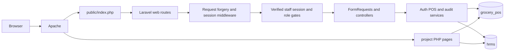

# GroceryOne architecture and request lifecycle

Updated 2026-10-26. Root is Laravel 13.38.0. The original page-oriented PHP/PDO
app remains under `project/`, with its own sessions/guards. Previous root MVC
code is preserved in protected ignored backups and is not autoloaded.
Full workflow migration remains incomplete.

## Native boundaries

- PublicController/ProductAvailability expose active catalog data and compute
  non-expired sellable stock. Image delivery resolves product IDs into bounded
  image directories and validates actual MIME; arbitrary paths are not inputs.
- StaffAuthentication resolves canonical POS/HR identities, checks status and
  stages unauthenticated email/recovery challenges. EnsureStaff checks MFA,
  current account status, force logout, password signature, idle expiry and
  per-domain/user session versions. Lost revocation cache invalidates sessions.
  StaffContext resolves the actual POS mirror for an HR administrator.
- CatalogAdminController uses an allowlisted registry and role-protected
  validated mutations. New products start at zero stock; category renames
  preserve textual product links within the transaction.
- PosService uses integer cents, locked products/batches, current server prices,
  approved discounts, details, logs and FEFO allocations in one POS transaction.
  Durable request keys/payload hashes prevent duplicate sales. Refunds restore
  original allocations and enforce remaining quantities. Same-day owner voids
  restore original stock/batches once and retain sale/log history.
- WorkspaceController provides scoped dashboard/sales lists and inventory.
  Admin-only direct restocking writes batch, stock, log, notification and audit
  records atomically. Inventory Staff retains the finance approval workflow.
- DomainAudit stores actor domain/ID, entity/action and changed field names,
  without submitted passwords, OTPs or before/after personal data. Existing
  stock-log UPDATE/DELETE protection triggers remain intact.
- DiscountApprovalService locks the cashier/pending request, derives basket
  quotes through PosService's shared product-price calculation and records
  Finance/Admin decisions. Existing discount_requests rows and a unique native
  checkout link enforce pending-to-decision and one-use checkout transitions.
  Approval never reserves stock; checkout still revalidates prices/availability.
- ProductLabelController bounds active product selections and produces escaped
  read-only print views. ProductLabelService validates and renders EAN-13 and uses
  a local BaconQrCode SVG writer for canonical public product URLs. No image
  upload, external QR service or label-time inventory mutation is involved.

Protected file sessions/cache and Vite-built Tailwind/CSS/JavaScript support
Blade pages. Output uses Blade escaping; cart product data uses textContent.
Public pages do not select personnel records. See [API](API.md) and
[database baseline/adoption](DATABASE.md).

## Transitional boundaries

Most HRMS, procurement, finance, advanced reports, nutrition/scanners and some
cashier/account flows remain in the preserved app and are linked from the
relevant navigation. Their sessions are not interchangeable with Laravel.
Independent POS/HRMS connection transactions do not establish atomicity across
the two databases. AccountSecurityService is an explicit exception: it verifies
the same MySQL server/credentials and InnoDB user tables, then uses qualified
schema names on one POS PDO transaction for both password updates, recovery-code
consumption and minimal audit. It locks POS then HR identities, verifies the
canonical domain, role/employee linkage and current employee eligibility, and
refuses ambiguous links or unsupported topology. Native session versions are
revoked after commit; password signatures also invalidate old native sessions.
No full parity is claimed; see [PARITY](PARITY.md) and [TESTING](TESTING.md).
The [pre-audit architecture draft](archive/2026-10-26-pre-audit-ARCHITECTURE.md)
is historical.

The shared MariaDB startup failure currently blocks live data access. Synthetic
tests use a separate localhost-only server with an exact project-local data
directory; production retains its original database configuration. Native
connection errors render generic retryable 503 responses without SQL details.

PublicProductFacts centralizes the active/verified SQL projection and comparable
category/basis/serving checks. PublicController uses that projection for details
and comparison, with one bounded related-product availability query. Choice lists
select only IDs/names (up to100); selected facts are limited to three. The native
editor/AI/photo-review workflow and private catalog/scanner analytics remain
separate pending ports; reading verified facts does not bypass their approval.

PublicProductCodeController validates the public code before any catalog SQL,
reads only active product IDs through the existing barcode index (maximum two
queries) and redirects to the existing product projection. Exact matches win;
only zero-prefixed GTIN-14 permits a 13-digit fallback. No scan-log or private
catalog/session mutation is introduced. Native camera/kiosk logic remains open.

ProductDiscountService separates Inventory/Admin proposals from Finance/Admin
decisions. Creation locks actor/product, derives price/old discount and checks
pending requests without changing inventory/prices. Transitions lock actor,
product then request and, for a new discount, remaining batches. Approval checks
snapshot equality and expiry before product, decision and minimal audit writes
inside one POS transaction. ProductDiscountController scopes Inventory history,
bounds options/history and maps HR Admin through StaffContext. It has no mail,
supplier, employee-record or stock mutation dependency.

ProductInformationController and ProductInformationService port the manual
description review lifecycle on existing tables. A keyed revision binds the
complete detail row, product and latest AI provenance context without a new
version column. Actor/product/detail locks precede state/revision checks and
atomic review/domain audit writes. HTML conflicts discard stale flashes. Admin
decisions use saved content; browser dirty-state checks prevent local unsaved
edits being mistaken for that content. Read-only nutrition and source review
does not invoke AI or load private photos. PublicProductFacts.safeSourceUrl is
shared by public facts, staff source display and new sanitized audit snapshots.

Native numeric ID routing now uses one Route::pattern before route registration. It rejects malformed paths before typed controller dispatch; UUID and barcode contracts remain distinct. FormRequest/service shared validators enforce existing signed ID bounds before operational lookups. CatalogAdminController normalizes optional category values to the original non-null representation rather than changing the schema.

OwnProfileController/Request/Service implement staff self-service through the
actual employee_id in either identity domain. Explicit projection avoids loading
payroll, government IDs and private files. ProfilePhone plus config/profile.php
preserve the32 original country-length choices without executing legacy config.
IdentityTransaction accepts feature-specific validation errors and retains its
password defaults. The profile service verifies the employee table's InnoDB
engine and writes qualified HR rows plus POS audit on one validated POS PDO.
An email-keyed named lock serializes native duplicate checks across employee
rows, checks connection ownership inside the transaction and releases explicitly
after transaction completion. Legacy writers are outside this advisory protocol.

OwnScheduleController delegates the authenticated model/domain to OwnScheduleService. The service rechecks the explicit employee link using eligibility fields only, reads bounded recurring and approved covering rows on HR, then constructs a fixed seven-day Asia/Manila preview. It imports no legacy PHP bootstrap, attendance processor or payroll calculation. Weekly shift precedence matches the legacy self-attendance resolver; the display remains separate from clock-in authorization.

OwnLeaveController/Request/Service implement shared own self-service for POS/HR. The service uses the explicit employee link and safe projections, with read-only balance defaults on GET. Writes use IdentityTransaction, lock current actor then actual employee and verify InnoDB HR employees/requests/credits. Qualified HR request/lazy vacation credit and POS audit share one commit. Employee locks serialize native identical pending retries across domains; legacy handlers do not participate. Decisions/credit deduction remain a separate traced port.

LeaveApprovalController/DecisionRequest, LeaveApprovalService and LeaveApprovalPolicy own native HR-domain review. A grouped highest-role projection avoids duplicate requester rows; SQL scope filters before pagination and private reason selection. Decisions lock current reviewer, employee rows in ID order, requester role rows/team mapping and the leave row, then recheck policy and keyed revision. Qualified HR credit/request/log writes plus POS audit use IdentityTransaction. Separate-process tests exercise same-request and shared-credit contention; legacy handlers remain outside the native locking protocol.

OwnOvertimeController/Request/Service own bounded self-service, using explicit employee linkage and IdentityTransaction for pending request plus domain audit. OvertimeEvidence is a pure recorded-work presenter preserving the existing current-schedule/fallback/early-arrival/overnight/rounding rules. Own history batches matching attendance and weekly rows for20 requests; it imports no legacy bootstrap or payroll executor. Pending retry serialization is native-only and normalizes stored two-decimal hours.

OvertimeApprovalController/DecisionRequest and OvertimeApprovalService own actual HR Admin/supervisor assigned-team review. The scope intentionally differs from LeaveApprovalPolicy and never grants HR Staff/Manager general overtime review. Queues batch only authorized attendance/weekly pairs and reuse OvertimeEvidence. Keyed proof binds request plus raw punch/shift/schedule type. IdentityTransaction locks/rechecks actor, employees, team, request and evidence before qualified HR status plus POS audit commit; legacy writers remain outside this native protocol.

## Original UI preservation, 2026-10-26

The later owner scope is stack-only migration. Standalone Blade home/login/catalog
views load separate `resources/css/legacy` and `resources/js/legacy` Vite entries,
without the superseded app.css/app.js redesign. Original CSS/theme sources and
licensed font assets remain separate from framework/business services. Config
`app.legacy_url` (LEGACY_APP_URL, default `/manage-grocery-main/project`) resolves
the remaining original workflow links. Laravel does not include legacy runtime.
Testing-only original presentation routes exist solely under APP_ENV=testing,
verify the nonce-marked pair and never include original bootstrap/config code.
The production route exporter excludes them. Remaining screens are not yet
visually restored; no session/feature or deployment-completeness claim follows.

## Product presentation continuation

The public product route now renders a standalone original-style Blade document
with legacy/product CSS/JS Vite entries, public data adapters and allowlisted
native return links. The stock color uses a per-element CSS custom property;
no PHP is passed into frontend CSS. Testing-only OriginalProductReference pins
the source fingerprint, extracts the original presentation as text and supplies
synthetic native public data without config, original queries or scan-log calls.
It is omitted from production route export, as with other original UI references.

## Original comparison presentation

Standalone `public.compare` loads exact source compare CSS and original theme JS
through Vite, without the superseded public layout/app stylesheet or web fonts.
The existing controller and public-facts guard own queries/selection. Presentation
uses Blade escaping and source row-minimum formatting. A testing-only pinned
OriginalComparisonReference extracts source presentation, removes the client
redirect branch and supplies synthetic native data; no original runtime/config/
query executes. Production route count remains58; test references are excluded.
