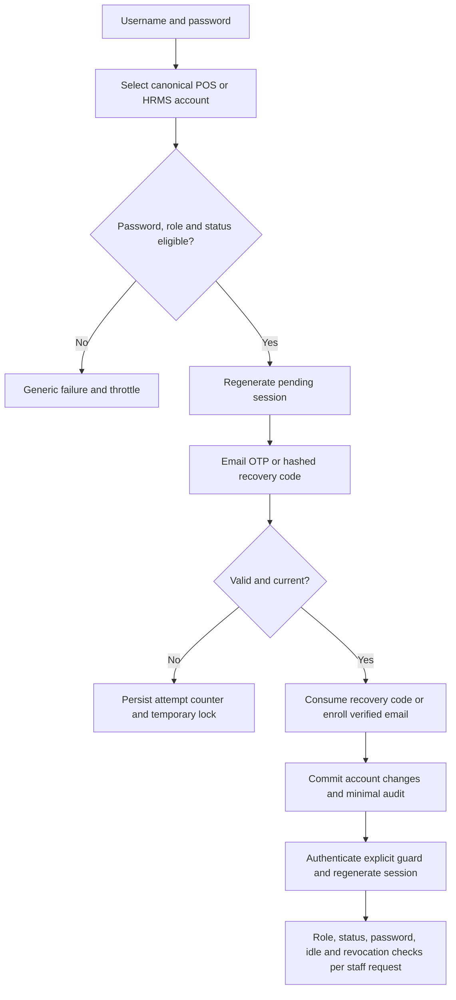
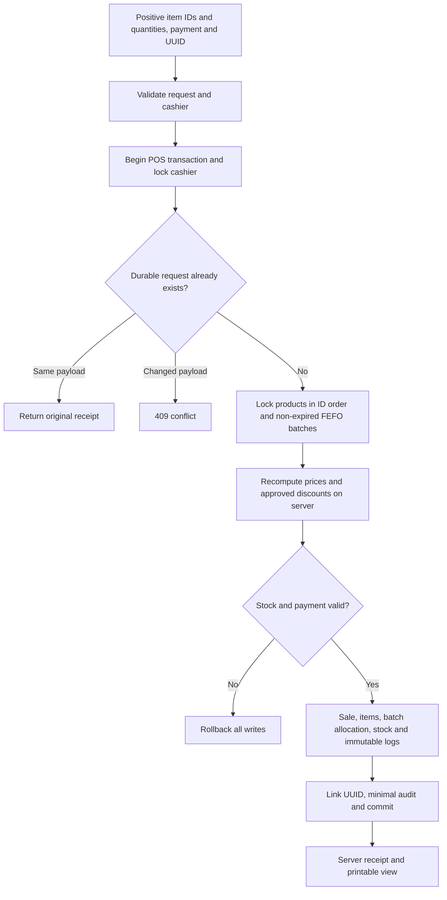
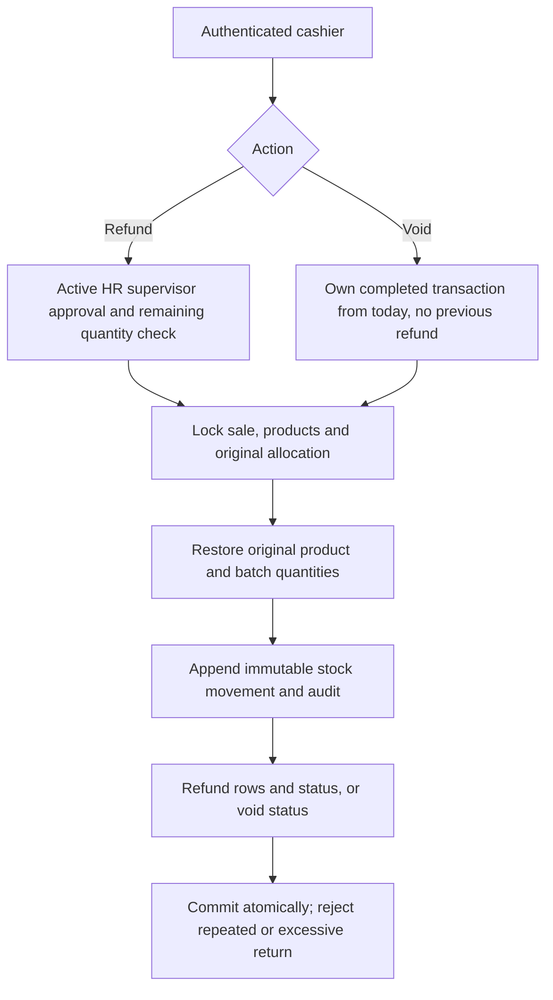
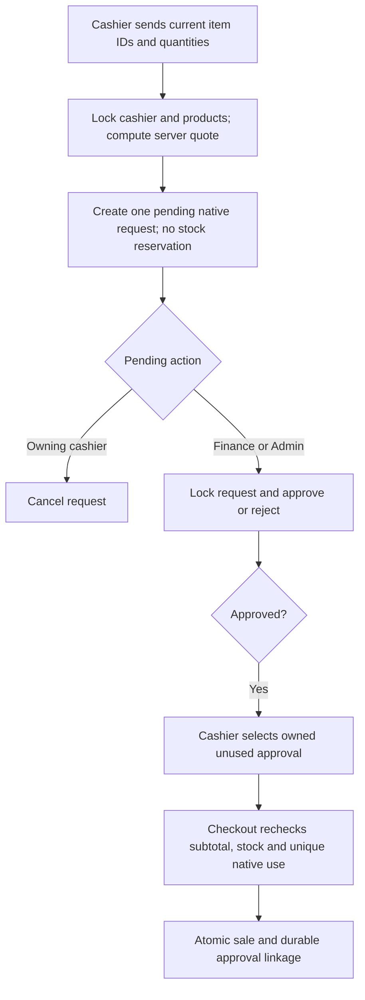
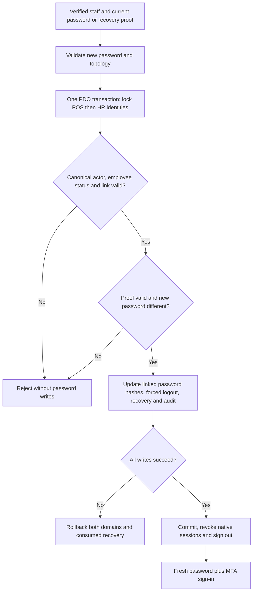
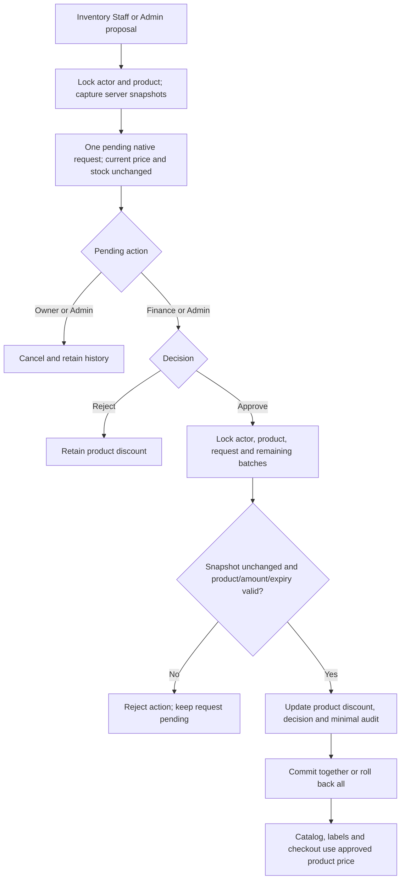
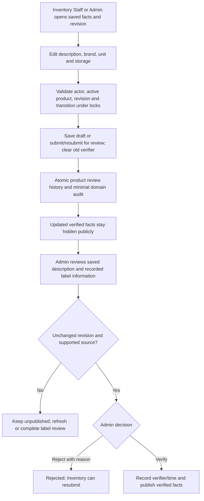

# Native Laravel workflows

Updated 2026-10-26. These diagrams describe implemented native behavior;
remaining legacy module flows are in project/HCI_SYSTEM.md.

## Staff authentication

## Cashier checkout

## Returns and voids

POS and HRMS connections are separate transaction domains. Supervisor lookup
and identity mapping do not make writes across both databases atomic. No
native payroll/procurement/DSR flow is asserted by these diagrams.
## Manual basket discount approval

The existing table has no historical cart fingerprint or legacy consumption
link. The port preserves subtotal-based approval matching; complete historical
reconciliation remains pending.

## Own-account password change

This uses qualified schemas on one verified same-server InnoDB connection. It
does not make arbitrary operations on separate PDO connections atomic.

## Product discount proposal

Separate native locks do not serialize older preserved PHP handlers. Admin's
existing ability to submit and decide is retained; no new two-person rule.

## Manual product information review

Both audit writes and the state change commit or roll back together. Web-derived
fields cannot be published through this manual description path. Local dirty
forms disable decision controls; server revisions protect the saved state.
