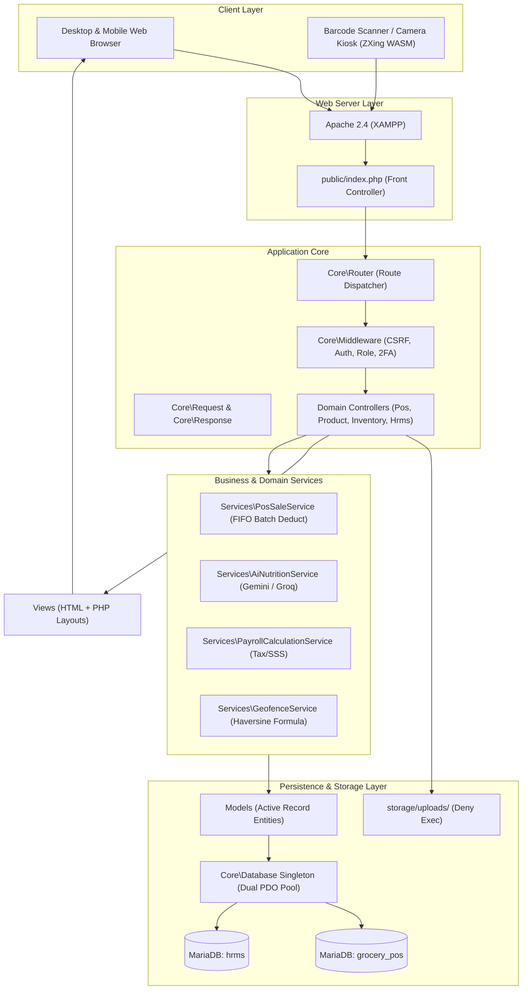
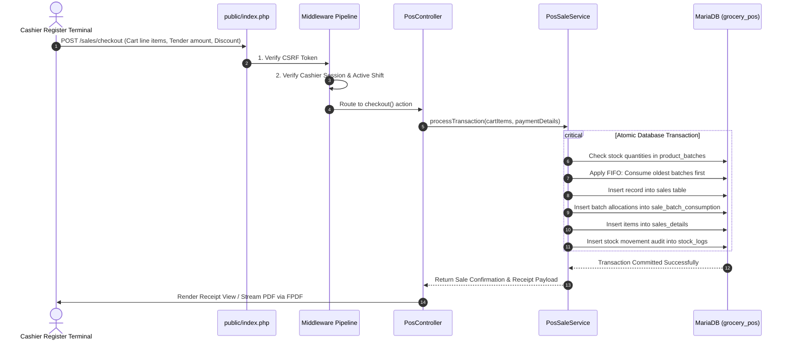

> Historical draft preserved before the 2026-10-26 audit correction.
> Its schema, security, runtime and legal-compliance claims are unverified or
> contradicted by the current audit. Do not use it for implementation,
> operations, retention decisions or release evidence. Read [the audit](../AUDIT.md)
> and the current [document](../ARCHITECTURE.md) instead.

# Manage-Grocery Architecture & Request Lifecycle

This document describes the layered MVC architecture, component boundaries, and request lifecycles of Manage-Grocery.

---

## 1. System Layers Overview

Manage-Grocery employs a modular Model-View-Controller (MVC) architecture specifically engineered for plain PHP 8, segregating public web traffic from core business services and database persistence.

---

## 2. Point of Sale (POS) Request Lifecycle

---

## 3. Subsystem Breakdown

### 3.1 Application Core (`app/Core/`)
- `Database.php`: Singleton PDO connection factory maintaining isolated connection pools for `grocery_pos` and `hrms` with UTF-8 character encoding and exception error modes.
- `Router.php`: Lightweight, high-performance regex router mapping clean URLs (`GET /sales`, `POST /inventory/adjust`) to controller actions.
- `Request.php` & `Response.php`: Clean HTTP abstractions providing sanitized input access, header management, and response formatting (JSON, HTML, file streaming).

### 3.2 Service Layer (`app/Services/`)
- `PosSaleService`: Encapsulates FIFO batch allocation logic, tax computations (12% VAT), and senior citizen / PWD discounts.
- `AiNutritionService`: Interacts with Gemini and Groq vision models to parse nutritional facts from uploaded package photos.
- `PayrollCalculationService`: Calculates Philippine statutory contributions including Social Security System (SSS), PhilHealth, Home Development Mutual Fund (Pag-IBIG), and withholding tax.
- `GeofenceService`: Computes Haversine great-circle distance between employee GPS coordinates and PCU Dasmariñas store coordinates.

