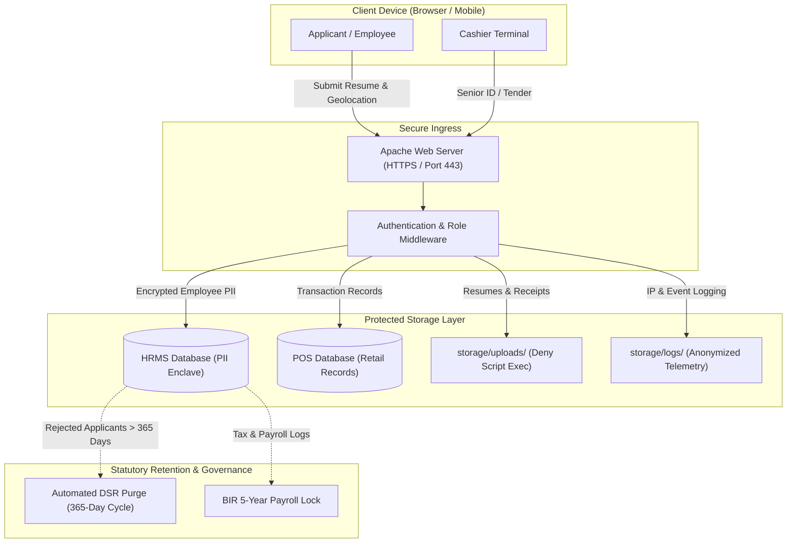

> Historical draft preserved before the 2026-10-26 audit correction.
> Its schema, security, runtime and legal-compliance claims are unverified or
> contradicted by the current audit. Do not use it for implementation,
> operations, retention decisions or release evidence. Read [the audit](../AUDIT.md)
> and the current [document](../PRIVACY.md) instead.

# Manage-Grocery Data Privacy Framework & RA 10173 Compliance

Manage-Grocery operates in full compliance with the statutory principles of transparency, legitimate purpose, and proportionality mandated by the **Philippine Data Privacy Act of 2012 (Republic Act No. 10173 - RA 10173)**.

---

## 1. Personally Identifiable Information (PII) Data Inventory

| Data Classification | Table Name | Specific Attributes Processed | Sensitivity Level | Justification / Processing Basis |
|---|---|---|---|---|
| **Employee PII** | `hrms.employees` | Full Name, Home Address, Contact Number, Emergency Contact, Birthdate, SSS, PhilHealth, Pag-IBIG, TIN | Sensitive Personal Information | Statutory employment & payroll compliance |
| **Applicant Data** | `hrms.applicant_applications` | Resume, Educational Background, Government IDs, Interview Notes | Sensitive Personal Information | Explicit consent given upon job application submission |
| **Attendance Biometrics / Geolocation** | `hrms.attendance` | Latitude, Longitude, Check-in Timestamp, Geofence Distance | Sensitive Personal Information | Employment contract & physical attendance verification |
| **Customer Identifiers** | `grocery_pos.sales` | Loyalty Member Number, Senior Citizen / PWD ID Number | Personal Information | Tax compliance & statutory senior discount verification |
| **Financial Signatures** | `grocery_pos.purchase_orders` | Procurement Officer Digital Signatures, Approver Signatures | Sensitive Personal Information | Financial fraud prevention and authorization audit |
| **System Security Logs** | `grocery_pos.login_ip_throttle` | Client IP Address, User Agent, Failed Login Count | Personal Information / Telemetry | Network security, fraud mitigation |

---

## 2. Data Subject Rights (DSR) & Workflows

Under RA 10173 Chapter VIII, data subjects retain explicit statutory rights:

1. **Right to Be Informed**: Notice provided during applicant submission (`apply.php`) and employee onboarding regarding HR and attendance processing.
2. **Right to Access & Portability**: Employees can access their attendance logs, payslips, and personal profile at any time via `my_profile.php`.
3. **Right to Rectification**: Employees can submit formal requests to correct inaccurate contact or dependent details.
4. **Right to Erasure / Blocking**:
   - Implemented via the `privacy_requests` table in the HRMS subsystem.
   - Rejected applicant documents are scheduled for automatic hard deletion after 365 days (`APPLICANT_REJECTED_RETENTION_DAYS=365`).
   - Active employee payroll history is exempt from immediate erasure due to mandatory 5-year Philippine Bureau of Internal Revenue (BIR) tax audit retention rules.

---

## 3. End-to-End Privacy Data Flow

