# HCI GroceryOne System Documentation

> **Comparison presentation continuation, 2026-10-26:** native comparison now
> preserves the original picker/table/theme and row-minimum green cells. NULL
> stays unknown and zero numeric; a single verified product has its label table.
> Native verified/basis/category/serving guards and current selections remain.
> Initial/table pixel evidence is bounded; minimum colors do not establish a
> dietary conclusion. Original SQL/private/scanner/staff parity remains open.
> **Product-detail UI continuation, 2026-10-26:** the native detail now preserves
> the original photo/price/stock, nutrition, information and related layout.
> Zero stays visible; unknown nutrient rows are omitted as in the source. Safe
> verified projection/URL/image rules remain. Known dashboard returns use native
> guarded routes; unknown destinations return to catalog. Empty-category related
> products follow the source. Private-session and scan-analytics parity remain
> open; no original PHP backend is included by this Blade conversion.

> **Later owner correction, 2026-10-26:** preserve the original UI and behavior;
> migrate the stack only. Home, initial login and public catalog now use the
> original presentation converted to Blade. Home restores four active stocked
> random products/nine category chips; catalog restores full results, category
> counts, stock-first order, automatic search and verified-allergen exclusion.
> Private access and password reset still use legacy guards/pages. Current native
> auth/availability safeguards remain. Other redesigned native screens still
> require restoration; earlier evidence does not establish original UI parity.

> **2026-10-26 migration update:** This remains the workflow reference for the
> preserved custom PHP app under `project/`. The separately authorized root
> migration now runs Laravel 13.38.0 at `/public/`, with native auth and retail
> core work plus remaining legacy links. See [current progress](../docs/PROGRESS.md),
> [native API](../docs/API.md) and [parity](../docs/PARITY.md). Legacy workflows
> remain available; this map does not claim full native parity. The later local
> startup repair intentionally changes the three legacy database bootstraps.

**Original PHP startup recovery, 2026-10-26:** `/project/index` and `/project/catalog`
now return HTTP 200 after recovery of the shared XAMPP MariaDB system tables.
The stalled server accepted TCP without sending a greeting; PHP waited before
rendering any HTML. Public bootstrap connections now use a three-second mysqlnd
network-read timeout as well as a three-second PDO connect option. This read
limit also applies to queries on those public connections. POS/HRMS primary and
cross-domain connections receive the connect option without changing their
network-read settings. All seven connections accept DB_PORT, default 3306.
Existing session/role gates, transactions and business schemas are preserved.
See PROGRESS for exact recovery, synthetic timeout and browser evidence.

Native retail additions now include FEFO checkout with durable request keys,
approved partial/full returns, owner-only same-day voids, current inventory
search/stock filters/expiry watch and administrator restock selection. Native
authentication always requires emailed verification or a one-use recovery code;
first verified enrollment issues hashed recovery codes once. Domain-specific
guards, password/idle/status checks and session revocation precede role gates.
Exact current evidence is in docs/TESTING and PARITY. The shared MariaDB startup
failure was subsequently recovered for the original PHP app; synthetic testing
still uses a separate project-local instance. Preserved legacy workflow descriptions below are dated
source descriptions and are not full Laravel acceptance results.

The native manual-discount flow now creates a server-priced cashier request,
permits Finance/Admin decisions on pending requests, supports owner cancellation
and supplies an owned, unused approval selector at checkout. Approval and
checkout are separate transactions; checkout rechecks subtotal, prices, stock
and single use. Ordinary/manual-approved sales discard unused senior/PWD
identity fields. Other legacy Finance functions described below remain pending.

Native label selection/printing now covers EAN-13 and shelf QR output for up to
96 active products, under Inventory Staff/Admin guards. It preserves existing
barcodes, validates checksum before drawing bars and uses the public Laravel
product URL in the shelf QR. Product labels/catalog/checkout share effective
pricing. Browser evidence decodes actual symbols and generates synthetic A4
output; physical printer/phone operation is not claimed.

Native public details/comparison now read only active products with verified
product_details. Draft/AI-filled/needs-review/rejected fields and internal staff
review metadata stay out of public views. Comparison preserves category/basis
guards, adds matching serving-size checks and keeps unknown values distinct from
zero without automatic unit conversion. Native edit/AI/photo/private-catalog
and scanner/lookup-log workflows remain pending; this is a bounded public port.

Native Account security now provides own password changes with current-password
or recovery proof, stronger confirmed-password validation and throttling. Exact
compatible POS/HR links update via one same-server qualified-schema transaction;
failed second-domain writes roll back both passwords, recovery consumption and
audit. Success revokes native sessions and requires fresh MFA. The form shows
masked verification email and a recovery count. This does not port the broader
legacy HR profile/avatar/password-reset administration workflows.

Native public GET /catalog/scan now resolves manual/keyboard-entered barcodes and
store codes to the public native product page. It preserves active-only exact
matching and leading-zero GTIN-14 fallback, bounded input and request limits.
Unknown/inactive codes share an empty state; invalid input is422. It introduces
no scan analytics or external lookup and does not unlock private kiosk/camera
access. Separate startup recovery restored live public availability; both app
homepages and this route returned200 in the latest read-only HTTP checks.

Native Product discounts now ports the product-level proposal/Finance decision
flow from products.php/finance.php. Inventory Staff/Admin submits server-snapshot
proposals; Finance/Admin decides pending requests. Approval rechecks price/current
discount/reason, activity and expiry and commits product/request/audit together.
Requests leave prices and stock unchanged. Inventory sees/cancels own history;
Admin cancellation is wider. Catalog CRUD rejects direct discount fields and
links to this form. Legacy Admin self-decision permission is retained. Broader
Finance/procurement and image/AI product editing remain pending.

Native manual product information now edits description/brand/unit/storage,
submits/resubmits and supports Admin-only verify/reject with atomic product and
domain audit. Saved nutrition/ingredient/source information is visible read-only
for review. Editing verified facts hides them until review; HMAC revisions catch
stale rows, nutrient changes and new AI provenance. Unsaved browser edits disable
decisions. Web-source/latest AI web fields retain the separate label-review gate;
this manual screen cannot publish them. Unsafe source references and private
audit/photo payloads stay out of display. Full nutrition/photo/AI editing remains
pending; no real facts were edited by migration tests.

Native numeric ID paths now share bounded positive decimal routing, preventing
oversized typed-argument errors. Operational body IDs respect the existing signed
integer range before business lookups. The native Uncategorized product choice
now maps to the original non-null empty text value on create/update, preserving
schema and stock; no category row is manufactured. Both regressions are tested
with synthetic records and the create/reopen UI path.

Native staff Personal information now uses GET/POST /account/profile for both
identity domains, through the authenticated account's employee_id only. Staff
may update nine contact/personal fields after current-password and stale-form
checks; employment, role, payroll and sign-in MFA email are outside the form.
Contact email confirmation is not delivery verification. Qualified HR employee
updates and minimal POS audit commit atomically. Native duplicate-email writers
serialize with a connection-checked advisory lock; legacy writers remain separate.
Unknown stored phone/option values can be retained without silent truncation;
HTML errors do not flash personal data. Synthetic tests and desktop/mobile
browser checks verify these bounds. Other profile attendance/leave/overtime/
payslip/avatar and administrative functions are still pending migration.

Native My schedule now displays only the signed-in linked employee's recurring
week and next seven Manila calendar days. Approved covering swaps apply only
without a weekly shift. Unconfigured, day-off, overnight, inactive and missing
shift-time states are distinct; no contact, colleague, swap reason or payroll
data is loaded. The view does not process attendance or determine clock-in, leave,
holiday or pay eligibility. HR company/team schedule management remains legacy.

Native My leave now supports own recorded/default balances,20-row filtered
history and pending request submission through the actual employee link. Vacation
uses existing start-year credit and calendar cooldown rules consistently across
POS/HR; sick/emergency reporting balances do not block filing. GET does not create
credits. Pending requests do not deduct/reserve balances. Native identical pending
retries return one request; request/lazy vacation credit/minimal domain audit are
atomic. Private reasons are escaped and absent from audit values/error input.
HR/supervisor decisions, credit deduction, cancellation and attachments remain
separate legacy workflows; this subset does not complete leave/payroll parity.

Native leave review is now available at /leave-approvals to actual HR-domain
Admin, HR Manager, HR Staff and supervisors within their current role/team
scope. Highest requester role handles duplicate accounts; non-Admin self review
is denied. Decisions bind to the reviewed request, recheck current scope and
vacation credit, and atomically commit status, tracked usage, actual HR actor log
and minimal domain audit. Sick/emergency remain uncapped by allocation; storage
bounds and existing start-year calendar charging apply. Separate HR/employee
browser sessions and process contention checks verify the bounded flow. General
HR dashboard, roster, attendance, cancellation, attachment and payroll functions
remain incomplete; earlier own-leave notes about legacy-only decisions are history.

Native My overtime now supports actual own employee pending requests and20-row
filtered history. True nonfuture dates, two-decimal0.01..12 hours, private brief
reasons and server-owned state are enforced. Request/audit commit together and
identical normalized pending retries return one row. Requested hours stay separate
from own recorded work/excess, using existing current-schedule/fallback/rounding
rules; early arrival is excluded and missing/invalid punches remain unknown. GPS,
financial fields and payroll writes are absent. Supervisor decisions/on-behalf
entry and payroll execution remain separate pending ports.

Native Overtime approvals now covers actual HR Admin all-assigned-team and
supervisor own-team queues/decisions. Requester and recorded-work figures remain
distinct. A reviewer-bound request/raw-evidence revision plus locked current
actor/team/work checks prevents stale or cross-context decisions. Terminal
status/actual HR actor/time and minimal audit commit atomically, without changing
requested hours, punches or payroll. Missing punches remain informational;
invalid future/zero/>12-hour and ineligible approvals are denied while rejection
is available. On-behalf logging, Admin team preview and broader payroll remain
separate; twelve native browser scenarios pass with the legacy outage skip explicit.

## Current implementation status

**Documentation review:** October 18, 2026. This describes the checked-out
source, not a guarantee about a production deployment.

**Coverage:** This is a feature and business-workflow map of the checked-out
application, organized around user-facing modules and their primary actions.
The master chart is a high-level orientation chart, not a representation of
every page, API endpoint, validation branch, scheduled task, shared helper, or
exception path. Page/action inventories and focused workflow charts below
provide the more detailed coverage. Route existence does not prove a feature
is enabled or correctly configured in a live deployment.

This document describes the current checked-out application at
`C:\xampp\htdocs\manage-grocery-main\project\`, served locally by Apache/XAMPP
at `http://localhost/manage-grocery-main/project/`.

The system is a custom modular PHP 8 application. It is not Laravel and does
not have a Bootstrap, Tailwind, React, Vue, Angular, Alpine.js, or jQuery
application framework. It uses:

- PHP 8 with server-rendered HTML/PHP pages.
- MariaDB/MySQL accessed through PDO.
- Custom CSS in `assets/css/` and `HRMS/assets/`.
- Mostly vanilla JavaScript in `assets/js/` and module asset folders.
- Font Awesome and SweetAlert2 on selected pages through CDN assets.
- Bundled PHPMailer, FPDF, PHP QR Code, ZXing WASM, and `html5-qrcode` libraries.
- A project `.env` loader for database and runtime configuration.

The local database snapshot was last verified on October 3, 2026. The source
and migration files have advanced since that snapshot, so table counts below
are snapshot facts rather than a claim about every live database:

| Database | Tables | Main responsibility |
|---|---:|---|
| `grocery_pos` | 42 | Products, sales, inventory, procurement, finance, and purchase-order receipts |
| `hrms` | 35 | Employees, applicants, attendance, leave, schedules, payroll, and HR workflows |

The POS database includes `purchase_order_receipts` and
`purchase_order_receipt_items`. The HRMS database includes the current HR
letters, reminders, events, templates, official-business, and overtime tables.
The latest procurement source migration is
`database/migrations/2026_10_03_hrms_purchase_order_requests.sql`. Apply and
verify all required migrations against the target database, and run the CLI
contracts in `tests/` against the release environment. The October 3 snapshot
does not establish current deployment readiness.

## Current directory structure

```text
project/
├── POS/public pages and operational PHP pages
├── HRMS/                    HR and payroll module
├── includes/                shared configuration, authentication, mail, and helpers
├── assets/css/              custom themes, dashboard, sidebar, and form CSS
├── assets/js/               browser scripts and barcode/QR libraries
├── database/                base schema and timestamped SQL migrations
├── tests/                   CLI readiness and workflow contracts
├── backup/                  database backup tooling and documentation
└── uploads/                 protected runtime-upload directories
```

## Framework classification

The application is page-oriented rather than a conventional Laravel MVC
project. Most feature pages load a shared configuration file, enforce session
and role checks, query the database with PDO, and render their own HTML. This
keeps the system dependency-light but means there is no framework-generated
`routes/`, `app/`, `resources/`, or `artisan` structure.

## Local runtime and store settings

With XAMPP Apache and MariaDB/MySQL running, the local URL is
`http://localhost/manage-grocery-main/project/`. Runtime credentials, API
keys, SMTP settings, and encryption keys belong in the private `.env` file.

The documented store is Philippine Christian University (PCU), Dasmariñas,
Cavite, at Emilio Aguinaldo Highway, Barangay Sampaloc I, Dasmariñas, 4114
Cavite, Philippines. Store hours are 6:00 AM to 5:00 PM, Monday through
Sunday; the documented hotline is 09948966218. Attendance is geofenced to the
corrected PCU address pin: 7XV6+3X2, Emilio Aguinaldo Hwy, Dasmariñas, 4114
Cavite, at 14°17'31"N 120°57'31"E (`14.2919444444, 120.9586111111`). The
geofence uses this center with the configured 500-meter radius.
[Open the corrected PCU point in Google Maps](https://maps.google.com/?q=14.2919444444,120.9586111111).
Confirm that this pin is the intended entrance or attendance area and verify
the location accuracy policy before production use.

## 1. System Identity and Purpose

HCI GroceryOne is an integrated grocery-business management system. It combines a public grocery storefront, point-of-sale operations, inventory and procurement, finance, human resources, recruitment, attendance, supervisor management, and payroll in one PHP/MySQL application.

The system has two connected operational areas:

- **POS and Business Operations:** sales, products, stock, suppliers, purchase orders, finance, expenses, reports, notifications, and cashier workflows.
- **HRMS:** employees, recruitment, documents, attendance, leave, schedules, supervisors, performance, payroll, payslips, announcements, and HR administration.

Its main purpose is to keep the store's commercial activity and its workforce activity connected. A sale changes inventory and contributes to financial reporting. A hired employee can become an HRMS user and, depending on position, can be synchronized with a POS account. Attendance and approved overtime feed payroll. Payroll and operating transactions support financial control and auditability.

This document describes the behavior represented by the current PHP files. Where a live database or production configuration is not available, the description identifies behavior inferred from source migrations and SQL queries.

---

## 2. Architecture at a Glance

### 2.1 Public layer

The public layer is available without an authenticated employee session:

- `index.php`: public grocery landing page with featured products, categories, company information, and careers entry.
- `catalog.php`: public product catalog and product search.
- `product_detail.php`, `nutrition_compare.php`, and `scan.php`: public product information, nutrition comparison, and QR/barcode lookup.
- `kiosk.php`: public in-store camera scanner with manual barcode entry.
- `HRMS/apply.php`: public job application form with dynamic application fields and resume upload.
- `HRMS/requirements_submit.php`: token-protected applicant requirements submission portal.
- `HRMS/privacy_request.php`: public privacy-request intake.

The public layer directs users to one of two employee login systems:

- `login.php`: POS login for cashier, inventory staff, and finance users.
- `HRMS/login.php`: HRMS login for admin, HR, HR manager, supervisor, and employee users.

### 2.2 POS database and application area

The POS application uses the `grocery_pos` database by default. Its principal business data includes users, products, categories, sales, sale items, refunds, stock logs, suppliers, purchase orders, inventory requests, discount requests, expenses, budgets, payments, financial transactions, notifications, and audit/export records.

Shared POS behavior is concentrated in:

- `includes/config.php`: database connection, migrations, session guards, role checks, and business helpers.
- `includes/sidebar.php`: POS navigation and module visibility.
- `includes/twofactor.php`: POS two-factor authentication.
- `includes/export.php`: CSV/XLSX/PDF export helpers and export logging.
- `includes/mailer.php`: POS email delivery, including OTP messages.

### 2.3 HRMS database and application area

The HRMS application uses the `hrms` database by default. Its principal business data includes users, employees, attendance, leave, shifts, holidays, overtime, official business, supervisor teams, performance records, documents, applicants, application fields, payroll records, payroll logs, announcements, HR audit records, and application settings.

Shared HRMS behavior is concentrated in:

- `HRMS/includes/config.php`: database connection, migrations, HRMS guards, employee checks, recruitment, attendance, and payroll helpers.
- `HRMS/includes/hr_sidebar.php`: HRMS navigation.
- `HRMS/includes/supervisor_sidebar.php`: supervisor navigation.
- `HRMS/includes/twofactor.php`: HRMS two-factor authentication.
- `HRMS/includes/application_form.php`: dynamic application form renderer.
- `HRMS/includes/applicant_actions.php`: recruitment action handlers.
- `HRMS/includes/mailer.php`: HRMS security and recruitment emails.

### 2.4 Shared integration

The two sides share employee identity and business context through synchronization and cross-database helper logic. POS accounts can be synchronized from eligible HRMS employees. HRMS employee records whose position is Cashier, Inventory Staff, or Accountant are routed to their synchronized POS account; this is distinct from the HRMS `accountant` role, which has its own read-only payroll queue. Employee status, suspension, deactivation, and forced logout affect access.

IDs used in URLs can be encrypted or obfuscated through `includes/id_crypt.php` and its HRMS counterpart. This is intended to avoid exposing raw database identifiers in links.

### 2.5 Technology, runtime, and integrations

| Layer | Checked-in implementation |
|---|---|
| Browser UI | Server-rendered HTML, custom CSS, and mostly vanilla JavaScript; this is not a single-page application. |
| Application server | Custom PHP 8 pages and shared includes. Apache `.htaccess` provides directory-index, URL rewrite, and access rules in the documented XAMPP setup. |
| Data access | MySQL/MariaDB through PHP PDO, using separate `grocery_pos` and `hrms` databases by default. |
| Frontend and PHP libraries | Project CSS/JavaScript plus vendored PHPMailer, FPDF, PHP QR Code, ZXing WASM, and `html5-qrcode`; selected pages use CDN-hosted fonts, icons, or SweetAlert2. |
| Configuration | Environment variables or a project-root `.env`, loaded by `includes/env.php`; server-level environment variables take precedence. Keep real credentials and keys out of source control and documentation. |
| Optional external services | SMTP for mail workflows; Gemini, OpenAI, or Groq through its OpenAI-compatible API for assisted product information; optional Tavily web search for supported product-information workflows. These integrations need credentials and runtime settings and are not guaranteed to be enabled. |
| Locale and business context | PHP time zone is set to `Asia/Manila`; financial display uses Philippine pesos. Attendance location policy and store details are environment/configuration dependent. |

The checked-out project does not include a Composer or npm dependency manifest,
so exact package versions and a single pinned PHP/MySQL version are not
declared there. Libraries are present in the source tree, and the local
instructions target Apache and MariaDB/MySQL under XAMPP. A production host
must independently satisfy the PHP extensions, Apache rules, database
permissions, writable upload/storage paths, HTTPS, and external-service
requirements used by the enabled features. Validate those requirements in
staging rather than inferring them from the local development setup.

---

## 3. High-Level Master Flowchart

```mermaid
flowchart TD
    A[Public Landing Page<br/>index.php] --> B[Product Catalog<br/>catalog.php]
    A --> C[Careers / Job Application<br/>HRMS/apply.php]
    A --> C0[Privacy request<br/>HRMS/privacy_request.php]
    A --> D[POS Login<br/>login.php]
    A --> E[HRMS Login<br/>HRMS/login.php]

    B --> B1[Product information and nutrition comparison]
    B1 --> B2[QR / barcode lookup<br/>scan.php]
    B2 --> B3[Verified details only for consumer-facing claims]

    C0 --> C01[Admin verifies identity and reviews request]
    C01 --> C02[Attach private response PDF]
    C02 --> C03[Time-limited response download]

    C --> C1[Applicant record created]
    C1 --> C2[Resume PDF uploaded]
    C2 --> C3[HR reviews applicant]
    C3 --> C4{Applicant decision}
    C4 -->|Reject| C5[Applicant rejected]
    C4 -->|Initial pass| C6[Interview stage]
    C6 --> C7[Final pass]
    C7 --> C8[Requirements email]
    C8 --> C9[Token applicant portal<br/>requirements_submit.php]
    C9 --> C10[HR verifies documents]
    C10 --> C11[Confirm hire]
    C11 --> C12[Employee and account created]

    D --> D1{Credentials valid?}
    D1 -->|No| D2[Failed-login tracking<br/>IP throttling]
    D2 --> D
    D1 -->|Yes| D3{2FA required?}
    D3 -->|Yes| D4[OTP or backup code]
    D4 --> D5{Verification valid?}
    D5 -->|No| D4
    D5 -->|Yes| D6[POS session]
    D3 -->|No| D6
    D6 --> P[POS Operations]

    E --> E1{Credentials and employee status valid?}
    E1 -->|No| E2[Lockout / inactive / suspended response]
    E2 --> E
    E1 -->|Yes| E3{2FA required?}
    E3 -->|Yes| E4[OTP or backup code]
    E4 --> E5{Verification valid?}
    E5 -->|No| E4
    E5 -->|Yes| E6[HRMS session and role routing]
    E3 -->|No| E6
    E6 --> H[HRMS Operations]

    P --> P1[Sales / POS]
    P --> P2[Inventory]
    P --> P3[Procurement]
    P --> P4[Finance]
    P --> P5[Reports / Notifications / Profile]

    P1 --> S1[Scan or search product]
    S1 --> S2[Cart and quantity]
    S2 --> S3[Discount or approval request]
    S3 --> S4[Checkout]
    S4 --> S5[Sale and sale items recorded]
    S5 --> S6[Stock reduced and stock log created]
    S6 --> S7[Receipt / shift report / financial data]

    P2 --> I1[Stock dashboard]
    I1 --> I2[Low-stock or expiry detection]
    I2 --> I3[Restock request]
    I3 --> I4[Validation]
    I4 --> I5[Finance approval]
    I5 --> I6[Delivery received]
    I6 --> I7[Stock and batches updated]

    P3 --> Q1[Supplier and vendor rating]
    Q1 --> Q2[Purchase order]
    Q2 --> Q3[Finance approval]
    Q3 --> Q4[Order and receive goods]
    Q4 --> Q5[Inventory and accounts payable]

    P4 --> F1[Capital transactions]
    P4 --> F2[Inventory and PO approvals]
    P4 --> F3[Operating expenses]
    P4 --> F4[Budgets and thresholds]
    P4 --> F5[Financial statements and analysis]
    F3 --> F6[Verify, approve, pay, audit]

    H --> H1[Admin]
    H --> H2[HR / HR Manager]
    H --> H3[Supervisor]
    H --> H4[Employee]
    H --> H5[Accountant: read-only payroll queue]

    H1 --> H1A[Users, roles, status, leave, POS snapshot]
    H1 --> H1B[Payroll approval and release with Finance]
    H1 --> H1C[System profile and 2FA]
    H1 --> H1D[Privacy request administration]

    H2 --> H2A[Employees and documents]
    H2 --> H2B[Recruitment and hiring]
    H2 --> H2C[Attendance, leave, schedules]
    H2 --> H2D[Payroll preparation]
    H2 --> H2E[Announcements and HR notifications]
    H2 --> H2F[Contracts and official letters]

    H3 --> H3A[Team attendance and schedule]
    H3 --> H3B[Leave, overtime, official business]
    H3 --> H3C[Late time-in and performance]
    H3 --> H3D[Inventory request and POS monitoring]

    H4 --> H4A[Profile and attendance]
    H4 --> H4B[Leave, overtime, official business]
    H4 --> H4C[Announcements and payslips]
    H2F --> L1[Draft and submit letter]
    L1 --> L2[Admin or HR Manager approval]
    L2 --> L3[Email secure recipient link]
    L3 --> L4[Recipient accepts and signs or declines]
    L4 --> L5[Letter event history]

    H2D --> Y1[Calculate payroll]
    H3B --> Y1
    Y1 --> Y2[Statutory deductions and adjustments]
    Y2 --> Y3[Submit payroll for approval]
    Y3 --> H5
    H5 --> Y4{Finance or Admin decision}
    Y4 -->|Reject| Y5[Return for correction]
    Y5 --> H2D
    Y4 -->|Approve| Y6[Approved and unpaid]
    Y6 --> Y7[Finance or Admin records payment]
    Y7 --> Y8[Released payslip]
    Y8 --> Y9[Upload and protect cash acknowledgement]
    Y8 --> H4C
```

---

## 4. Roles and Responsibilities

### 4.1 Public visitor, customer, and applicant

The public user does not have an employee session. The public user can view the landing page, browse active products and available categories, open the catalog, and access the careers application. Applicants can submit an application, upload a resume, and later submit requested requirements through a token-protected portal. Visitors can also open product details, compare available nutrition information, and look up products using QR/barcode flows. The in-store kiosk supports camera scanning and manual barcode entry. A Supervisor-configured password gates private catalog mode.

The public catalog is informational. The source map does not identify a public customer checkout account; sales are handled through the authenticated POS. `HRMS/privacy_request.php` is a separate public intake for personal-information access, correction, deletion, portability, restriction, objection, or other privacy requests. It is distinct from the applicant requirements portal.

### 4.2 Admin

Admin is the highest operational role across the system. Admin capabilities include:

- Manage POS and HRMS user accounts.
- Assign roles and activate, deactivate, force-log out, or delete accounts where permitted.
- Reset user passwords.
- View operational snapshots and pending approvals.
- Manage employees, recruitment, documents, announcements, and leave decisions.
- Approve or reject payroll with Finance, then record payment/release where permitted.
- Review and process privacy requests, including identity verification and private response delivery.
- Maintain admin profile, avatar, 2FA email, and backup codes.
- Access broad finance, vendor, purchase order, and reporting functions.

Admin is also allowed to use supervisor tools and can inspect another supervisor's team using an encrypted supervisor identifier where implemented.

### 4.3 Cashier

The cashier operates the sales counter through `pos.php`.

Purpose:

- Process customer purchases.
- Search, scan, and add products to a cart.
- Change quantities and remove items.
- Apply eligible discounts.
- Request approval for custom discounts when required.
- Complete checkout and issue a receipt.
- Process authorized voids and refunds.
- Time in and submit late-time-in requests.
- View personal profile information, attendance information, and payslips.
- Review personal or authorized shift reports.

Cashier access is routed through POS login. Cashier accounts require POS 2FA according to the current authentication flow.

### 4.4 Inventory Staff

Inventory staff manages product availability and stock control.

Purpose:

- Monitor total, low, and out-of-stock inventory.
- Add, edit, delete, and restore products.
- Manage product barcodes, categories, price, supplier, expiry, image, and discount data.
- Inspect product batches and apply FEFO-oriented batch handling.
- Mark spoiled or wasted stock.
- Submit and manage restock requests.
- Validate or reject requests where the workflow assigns that responsibility.
- Receive approved deliveries and fulfill requests.
- Review stock movement and expiry reports.
- Manage supplier records when permitted.
- Add vendor ratings.

Direct restocking is restricted in favor of the approval workflow where the current implementation requires it.

### 4.5 Finance

Finance controls financial decisions and financial visibility.

Purpose:

- Review pending inventory requests, purchase orders, and discounts.
- Approve or reject financially controlled requests.
- Record capital transactions.
- Record and monitor accounts payable and supplier payments.
- Manage expense categories and budget thresholds.
- Review operating expenses and their approval/payment status.
- Analyze income, expenses, cash flow, balance sheet, trends, and budget versus actual values.
- Review financial audit logs.
- Export statements, analyses, reports, and payment information.

Finance is the main approval authority for requests that create financial obligations.

### 4.6 HR Staff

HR staff maintains employee and workforce records.

Purpose:

- Review and manage applicants.
- Progress applicants through interviews and hiring.
- Review resumes and applicant documents.
- Maintain employee records and documents.
- Handle attendance corrections, holidays, shift swaps, and leave workflows.
- Review late time-in requests.
- Prepare payroll and submit it for approval.
- Manage HR announcements and notifications.

HR staff has broad personnel access but does not automatically have every Admin-only function.

### 4.7 HR Manager

The HR Manager provides higher-level HR oversight.

Purpose:

- Manage or supervise HR staff workflows.
- Manage dynamic application-form fields.
- Oversee applicants and employee records.
- Review workforce metrics and HR reports.
- Participate in payroll preparation and submission.
- Approve HR-level requests where the workflow allows it.

Some document and resume actions are intentionally limited by role. The current source map identifies HR Manager as view-only for employee documents in one area and excludes HR Manager from protected resume download endpoints.

HR Manager can also approve or reject submitted HR letters and contracts. The
HR Manager is not the Admin-only privacy-request reviewer.

### 4.8 Supervisor

A supervisor manages an assigned team and selected operational requests.

Purpose:

- View team dashboard and KPIs.
- Monitor attendance and schedules.
- Approve or reject team leave.
- Approve, reject, or log overtime.
- Approve or reject official-business requests.
- Approve or reject late time-in requests.
- Add or delete merit/demerit performance records.
- Submit or cancel inventory restock requests.
- Monitor POS activity and prepare team reports.
- Generate supervisor-approved discount codes where permitted.

Supervisor actions apply to the supervisor's team. Admin can inspect another supervisor's team through the supported encrypted identifier mechanism.

Supervisors can also submit/track their own purchase-order requests and
configure the password used to unlock private catalog mode.

### 4.9 Employee

Employees use HRMS self-service features.

Purpose:

- View and update allowed personal information.
- Upload or remove a profile picture.
- View attendance calendar and leave balances.
- Request leave, overtime, and official business where available.
- Read announcements and notifications.
- View released payslips.
- Use time-in/time-out features according to employee status and position.

Employees do not receive access to administrative pages unless their assigned role grants it.

### 4.10 Accountant (HRMS role)

The HRMS `accountant` role has a read-only view of submitted payroll batches
waiting for a Finance/Admin decision. It cannot approve, reject, or release
payroll. Finance or Admin makes the approval decision and records payment.
This HRMS role must not be confused with an employee whose HRMS position is
Accountant: that employee account is synchronized to the POS Finance role and
does not use the HRMS employee login.

---

## 5. Authentication, Authorization, and Security

### 5.1 Separate login entry points

The application intentionally separates workforce entry points:

- POS positions use `login.php`.
- HRMS roles use `HRMS/login.php`.
- POS-oriented positions are prevented from using HRMS login through the configured position restrictions.
- The HRMS `accountant` role is a separate read-only payroll reviewer; an employee whose position is Accountant is synchronized to POS Finance instead.
- Admin is directed to the HRMS login rather than the POS login.

### 5.2 Session controls

The source map identifies the following controls:

- Approximately 30-minute inactivity timeout.
- Database-backed `force_logout` handling.
- Account `is_active` checks.
- Employee eligibility checks for POS access.
- Employee status checks for HRMS access, including active, resigned, and terminated states.
- Suspension-date and account-deactivation checks.
- Failed-login tracking and IP throttling.
- Session clearing and cookie deletion on logout.

### 5.3 Two-factor authentication

The POS and HRMS systems implement parallel 2FA flows:

1. The password is checked.
2. A pending authentication session is created without the normal user session identifier.
3. The user receives or enters a six-digit OTP, or uses a backup code.
4. The OTP expires after approximately ten minutes.
5. The number of attempts is limited.
6. Eight one-time backup codes are supported.
7. The normal authenticated session is created only after successful verification.

Setup and verification pages are available in both the root and HRMS areas.

### 5.4 File protection

The system supports protected download endpoints for resumes, applicant documents, employee documents, and payroll cash acknowledgements. Uploads are validated by extension and, in important paths, by PDF magic bytes or image signatures.

The project Apache rules deny direct access to dotfiles and selected
sensitive file extensions, disable directory listings, and restrict the
in-store kiosk route to localhost or configured private network ranges.
These rules depend on Apache honoring the project `.htaccess`; they do not
replace authorization checks in the PHP download handlers or equivalent
web-server controls on a different hosting platform.

### 5.5 Configuration and error handling

Database credentials are loaded through `includes/env.php` and `.env` values when available. The POS configuration defaults to the `grocery_pos` database and the HRMS configuration defaults to `hrms`.

Development and production error-display behavior is controlled by `APP_ENV`. Production-style settings hide browser error output and log errors instead. Database migrations are idempotent and are checked through configuration-based migration logic.

### 5.6 Password recovery

`password_reset_request.php` accepts a POS or HRMS account selector and a
username or verified account email. The response is generic so it does not
confirm whether an account exists. Eligible requests are recorded and
acknowledged at the account's verified address. HR/Admin review the queue in
`HRMS/password_reset_requests.php`; an approved request receives a one-time
reset link at that verified address. The token expires and can only be used
once. Completing the reset changes the password, invalidates the reset token,
and forces the account to log in again. Recovery requests can also be
dismissed/handled from the review queue.

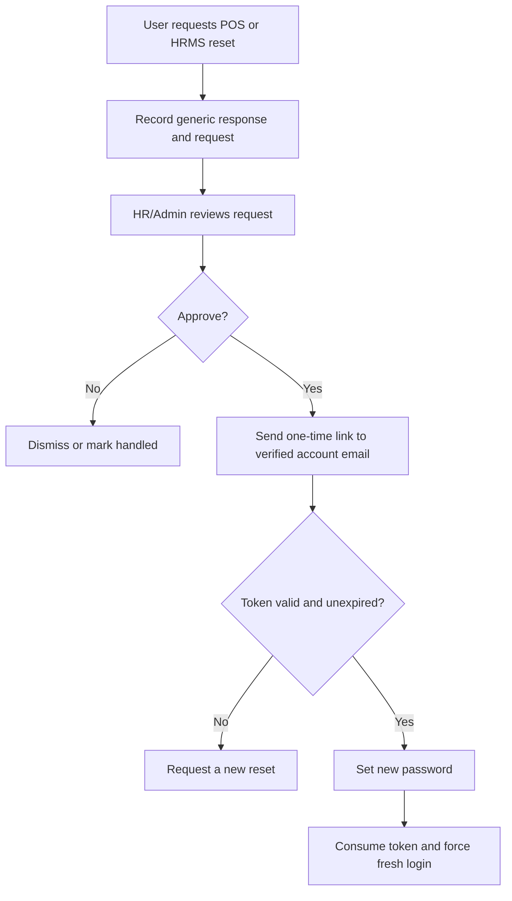

---

## 6. Public Website and Catalog

### `index.php`: landing page

Purpose: introduce the grocery business and provide controlled entry into the public and employee areas.

Features:

- Shows active products with stock.
- Shows categories that currently have available products.
- Provides product catalog navigation.
- Provides POS login access.
- Provides HRMS/careers access.
- Displays company commitments, team information, and careers content.
- Uses responsive styling and light/dark presentation behavior.

### `catalog.php`: product catalog

Purpose: allow visitors to inspect products without an employee account.

Features:

- Displays products and categories.
- Supports catalog browsing and search behavior.
- Uses product availability data from the POS database.
- Directs store transactions to the authenticated POS rather than performing public checkout.

### `HRMS/apply.php`: public recruitment

Purpose: collect job applications.

Features:

- Renders configurable application fields.
- Collects applicant information.
- Accepts a resume upload.
- Creates an applicant record.
- Sends related notification email where configured.
- Requires acknowledgement of the applicant privacy notice before submission
  and retains the notice version/consent timestamp.

### Product discovery, scanning, and private catalog

- `product_detail.php` presents available product details, nutrition facts,
  ingredients, allergens, storage information, and related products.
  Consumer-facing descriptive details carry a review status and should not be
  treated as verified claims until approved.
- `nutrition_compare.php` compares available nutrition information for
  products with recorded nutrition data.
- `scan.php` resolves a product by encoded identifier or barcode/store code
  and records lookup activity. `scanner.php` provides an authenticated phone
  scanner; `kiosk.php` provides an in-store camera scanner and manual barcode
  entry.
- `catalog_supervisor_login.php` gates entry to and exit from private catalog
  mode using a Supervisor-configured password. `catalog.php` renders the
  public/private catalog.
- `HRMS/privacy_request.php` accepts a privacy request but does not itself
  verify identity, decide the request, or guarantee fulfillment.

---

## 7. POS Sales and Cashier Operations

### `pos.php`

Purpose: operate the store checkout process.

Main actions:

- `add_to_cart`: add a product to the active cart.
- `scan_barcode`: locate a product by barcode.
- `update_qty`: change cart quantity.
- `remove_item`: remove a cart item.
- `apply_discount`: apply an eligible discount.
- `cancel_discount_request`: cancel a pending discount request.
- `checkout`: finalize the sale.
- `void`: void an authorized transaction.

Business outcomes:

- A sale creates a sale record and sale-item records.
- Stock is reduced.
- Stock movement is recorded.
- The receipt can be rendered.
- Sales become available to reports, shift summaries, and financial analysis.
- Refunds and partial refunds create corresponding refund records where supported.

### `shift_report.php`

Purpose: reconcile cashier activity by shift.

Features:

- Shows transactions and products sold.
- Shows discounts and cash received.
- Allows authorized users, including Admin, to inspect other cashiers where permitted.
- Supports CSV export.

### `payslip_view.php`

Purpose: give POS-side employees access to their payroll information and related acknowledgement viewing through protected HRMS endpoints.

### Sales flowchart

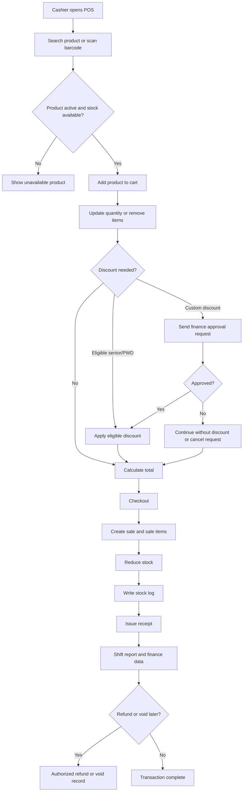

---

## 8. Inventory Management

### `inventory_dashboard.php`

Purpose: provide a quick stock-health view.

Features:

- Total inventory measures.
- Low-stock and out-of-stock counts.
- Stock snapshots.
- Recent sales context.

### `products.php`

Purpose: maintain the sellable product catalog used by POS and public pages.

Features:

- Add, edit, delete, and restore products.
- Maintain barcode and category.
- Maintain selling price and stock.
- Link products to suppliers.
- Track expiry information.
- Upload product images.
- Create or cancel product discount requests.

### `inventory.php`

Purpose: handle direct stock adjustments and legacy restock paths. The current workflow restricts direct restocking in favor of approved requests where required.

### `product_batches.php`

Purpose: track stock by batch and support expiry-aware handling.

Features:

- Inspect product batches.
- Support FEFO-oriented stock handling.
- Mark wasted or unusable stock.

### `inventory_requests.php`

Purpose: move stock replenishment through a controlled workflow.

Actions:

- `submit_request`: request replenishment.
- `cancel_own_request`: cancel a request created by the requester.
- `validate`: validate request details.
- `reject_validation`: reject an invalid request.
- `fulfill`: receive and fulfill an approved request.

Typical statuses include pending validation, pending finance, approved, rejected, and fulfilled.

### `inventory_reports.php`

Purpose: support stock accountability.

Features:

- Stock movement audit trail.
- Expiry summary.
- CSV, XLSX, and PDF export.

### Product information, shelf labels, and scan insights

- `product_details_edit.php` lets Inventory Staff save, submit, and resubmit
  product descriptions, brand, unit, and storage notes. Admin can verify or
  reject submitted details; review actions are audited.
- `ai_product_ingest.php` drafts product information from an image for
  Inventory Staff. Nutrition-panel and front-of-package modes use different
  extraction/search paths, described in [Front-photo nutrition
  lookup](#24-front-photo-nutrition-lookup). AI output remains draft data and
  does not approve products, prices, purchases, or other business decisions.
- `ai_settings.php` lets Admin configure and test the provider/model,
  enablement, daily AI-call and web-search caps, and inspect recent usage.
- `shelf_labels.php` produces printable QR labels linking to product details.
  `product_barcode_labels.php` prints POS barcode labels for active products
  with supported EAN-13 barcodes.
  `scan_insights.php` summarizes customer lookups by source/date and
  highlights frequently scanned products without verified details.
- `stock_recommendations.php` is a read-only planning report; it does not
  approve or execute a restock.

Product information and customer discovery flow:

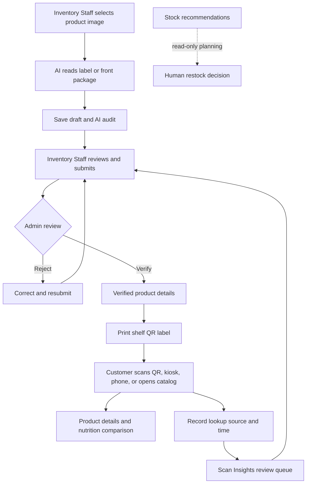

### Inventory flowchart

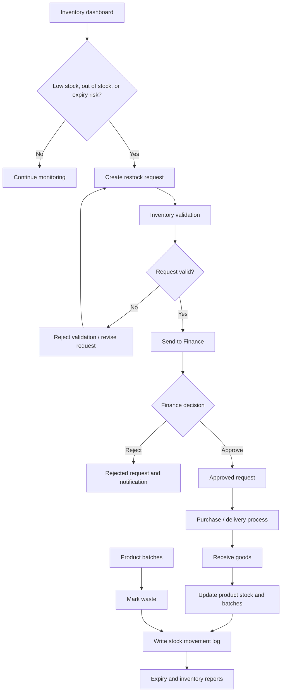

---

## 9. Procurement, Suppliers, and Purchase Orders

### `suppliers.php`

Purpose: maintain the supplier directory.

Features:

- Add suppliers.
- Edit supplier information.
- Deactivate suppliers.
- Export supplier lists to XLSX or PDF.

### `vendor_ratings.php`

Purpose: record supplier performance and support purchasing decisions.

Permissions:

- Admin and Finance have full vendor-rating management.
- Inventory Staff can add ratings.
- Shared action functions provide the underlying add/edit/delete behavior subject to role checks.

### `purchase_orders.php`

Purpose: formalize purchasing from suppliers.

Actions:

- `create`: create a purchase order and line items.
- `submit_for_approval`: send the order to Finance.
- `mark_ordered`: record that the supplier order was placed.
- `receive`: receive the ordered goods.

Purchase orders can be filtered and exported as a list or individual XLSX/PDF
documents. Inventory Staff are scoped to their department, and Finance reviews
and approves submitted orders. Standard approved orders can be marked ordered;
supplier acceptance moves eligible restock orders into the Orders queue.

Inventory restock requests can contain multiple lines. Finance approval creates
a purchase order linked to the source request. Supplier acceptance moves that
order into the Orders queue, and receiving fulfills the linked request. HR
Staff and Supervisors can submit curated, role-appropriate supply requests
directly to Finance and track their own submissions. Admin preview of these
requests is read-only.

For linked restock and HR/Supervisor orders, the system can send a tokenized,
expiring supplier approval link. The supplier reviews the order/formality
letter and draws an e-signature; acceptance moves eligible orders to the
ordered state and notifies Admin to coordinate delivery. Standard purchase
orders may instead use the in-app `mark_ordered` action.
`procurement_letter.php` and `purchase_order_letter.php` render printable
request/order letters. `supplier_inventory_approval.php` and
`supplier_purchase_order_approval.php` handle supplier e-signature responses.
Admin enrolls reference signatures through
`procurement_signature_enrollment.php`; Finance can visually compare the
enrolled reference with signatures before continuing. This is a manual review,
not an automated signature-identity guarantee.

Receiving records actual quantities, updates stock and batches, creates or
updates Accounts Payable, and saves item-level receipt history. The system
generates the receipt record from the receiving quantities; an uploaded receipt
document is not required by the current workflow. Inventory Staff may receive
eligible orders for their department; Admin can receive HR and Supervisor
orders.

Finance and Admin can view the date-filtered procurement financial summary. It
uses shared statement and cash-flow helpers, distinguishes recognized costs
from cash payments, and discloses legacy sold quantities without known batch
cost instead of guessing COGS. Capital contributions and withdrawals are
financing flows, not income or expenses.

Apply the procurement migrations in order to `grocery_pos` before deploying
source that depends on them:

1. `database/migrations/2026_10_01_procurement_routing_receipts.sql`
2. `database/migrations/2026_10_02_procurement_request_po_links.sql`
3. `database/migrations/2026_10_03_hrms_purchase_order_requests.sql`

These migrations are designed to be rerunnable. Confirm the target database,
take a backup, verify migration results, and confirm PHP's storage permissions
before release.

### Procurement flowchart

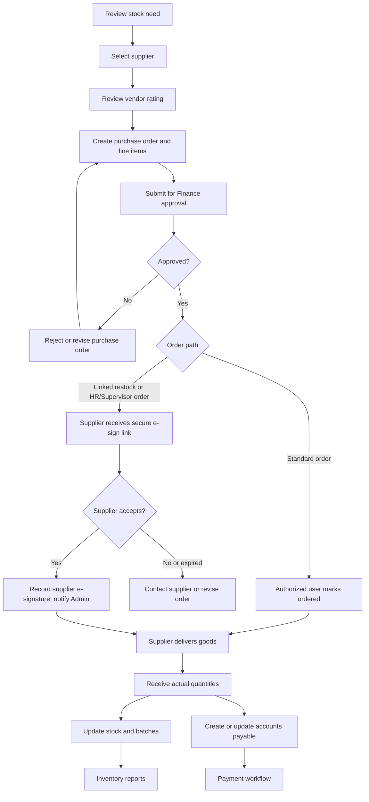

---

## 10. Finance and Accounting Controls

### `finance_dashboard.php`

Purpose: show Finance the decisions requiring attention.

Displays may include:

- Pending inventory requests.
- Pending purchase orders.
- Pending discount approvals.
- Financial analytics and exports.

### `finance.php`

Purpose: execute financial approvals and record capital activity.

Actions:

- `add_capital_transaction`.
- `finance_approve` and `finance_reject` for inventory-related requests.
- `finance_approve_po` and `finance_reject_po` for purchase orders.
- `finance_approve_discount` and `finance_reject_discount` for discount requests.

### `accounts_payable.php`

Purpose: record payments and outstanding financial obligations related to purchase orders, inventory requests, and operating expenses.

### `operating_expenses.php`

Purpose: encode expenses with evidence and route them through verification, approval, and payment.

Features and actions:

- `encode`: create an expense and upload the required receipt.
- `submit`: send the expense for review.
- `verify`: verify expense details.
- `return`: return an expense for correction.
- `resubmit`: send corrected data back into review.
- `level2_approve`: complete the higher-level approval stage.
- Pay the approved expense.
- Export expense records to XLSX/PDF.

### `budgeting.php`

Purpose: plan spending and compare planned values with actual expenses.

Actions:

- `save_budget`.
- `delete_budget`.
- Budget-versus-actual analysis.

### `expense_categories.php`

Purpose: standardize how expenses are classified and control category thresholds.

Actions:

- `save_category`.
- `deactivate_category`.
- `save_threshold`.

### `financial_statements.php`

Purpose: produce financial statements.

Outputs:

- Income statement.
- Balance sheet.
- Cash flow statement.
- XLSX/PDF exports.

### `financial_analysis.php`

Purpose: help Finance interpret performance.

Outputs:

- Monthly trends.
- Expense breakdown.
- Summary analytics.
- XLSX/PDF exports.

### `financial_audit_log.php`

Purpose: provide a trace of important financial events with date filtering and XLSX/PDF export.

### Finance flowchart

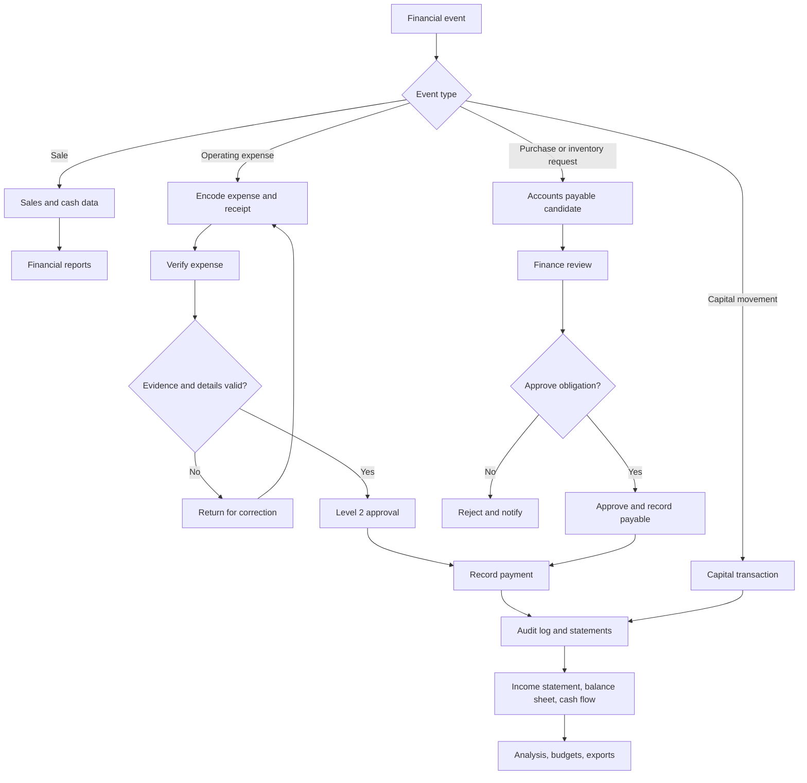

---

## 11. Recruitment and Employee Lifecycle

### Recruitment stages

1. A visitor opens the careers section.
2. The applicant completes the dynamic application form.
3. The applicant uploads a resume PDF.
4. The system creates an applicant record and can send notification email.
5. HR reviews the applicant.
6. HR can pass the applicant to interview, pass initial screening, pass final screening, or reject the applicant.
7. Successful applicants receive requirements instructions.
8. The applicant submits required documents through a token-protected portal.
9. HR reviews, uploads, or deletes applicant documents as permitted.
10. HR confirms the hire.
11. The employee record, status, position, and account information are established.
12. The employee becomes available for HRMS workflows and, when eligible, POS synchronization.

### `manage_application_form.php`

Purpose: let HR Manager/Admin configure application fields.

Actions:

- Add, edit, activate, deactivate, delete, and reorder fields.

### `applicant_review.php`

Purpose: manage the applicant pipeline.

Actions:

- `advance_to_interview`.
- `pass_initial`.
- `pass_final`.
- `resend_requirements_email`.
- `upload_applicant_document`.
- `delete_applicant_document`.
- `confirm_hire`.
- `set_orientation_date`.
- `reject_applicant`.

### `employees.php`

Purpose: manage active employees and employment status.

Features:

- Search and edit employee records.
- Suspend and lift suspension.
- Offboard employees.
- Continue the applicant-to-employee pipeline.
- Upload and review applicant-related documents through shared actions.

### Recruitment flowchart

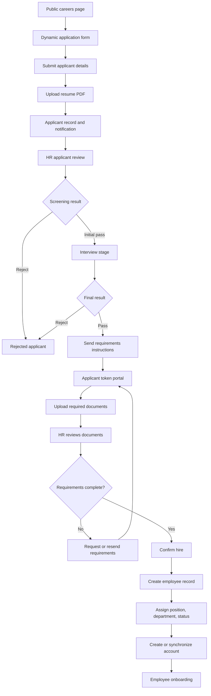

### HR contracts and official letters

`HRMS/hr_letters.php` lists letter records and supports submission, approval,
rejection, and sending/resending eligible letters. HR Staff can create and
submit letters; Admin and HR Manager can approve or reject pending letters.
Templates are created in `HRMS/hr_letter_templates.php`; drafts are composed
or edited in `HRMS/hr_letter_edit.php`. Contracts for applicants are restricted
to applicants at the final hiring-approval stage and require contract dates and
duration. After approval, an applicant contract is emailed to the applicant.
The token-protected `HRMS/letter_recipient.php` lets the recipient accept and
draw an electronic signature or decline; the system records the response and
letter event. An authorized HRMS user can also record a drawn signature or
attach an externally signed PDF using `HRMS/hr_letter_signed.php`; the PDF is
available through the protected `HRMS/hr_letter_download.php` endpoint. HR can
process reminders for letters sent more than seven days ago using
`HRMS/hr_letter_reminders.php`.

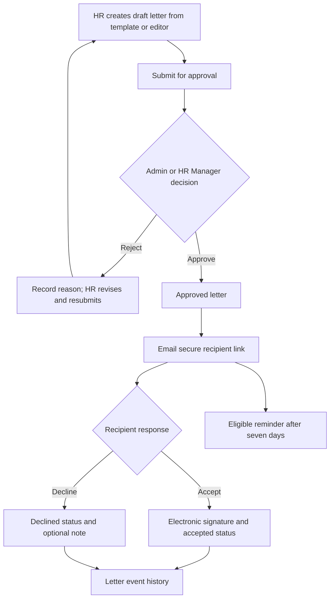

### Privacy request workflow

The public `HRMS/privacy_request.php` form records the requester's name,
contact email, request type, and details. Admin processes requests in
`HRMS/privacy_requests.php`: records identity-verification notes, updates
review status, and can attach a private PDF response after verification.
Marking a request fulfilled requires identity verification and a valid
response PDF. The protected response link expires after seven days. Denials
require internal notes, and actions are written to the HR audit log. The
workflow records and routes requests; it does not guarantee that every
requested action is legally or operationally available.

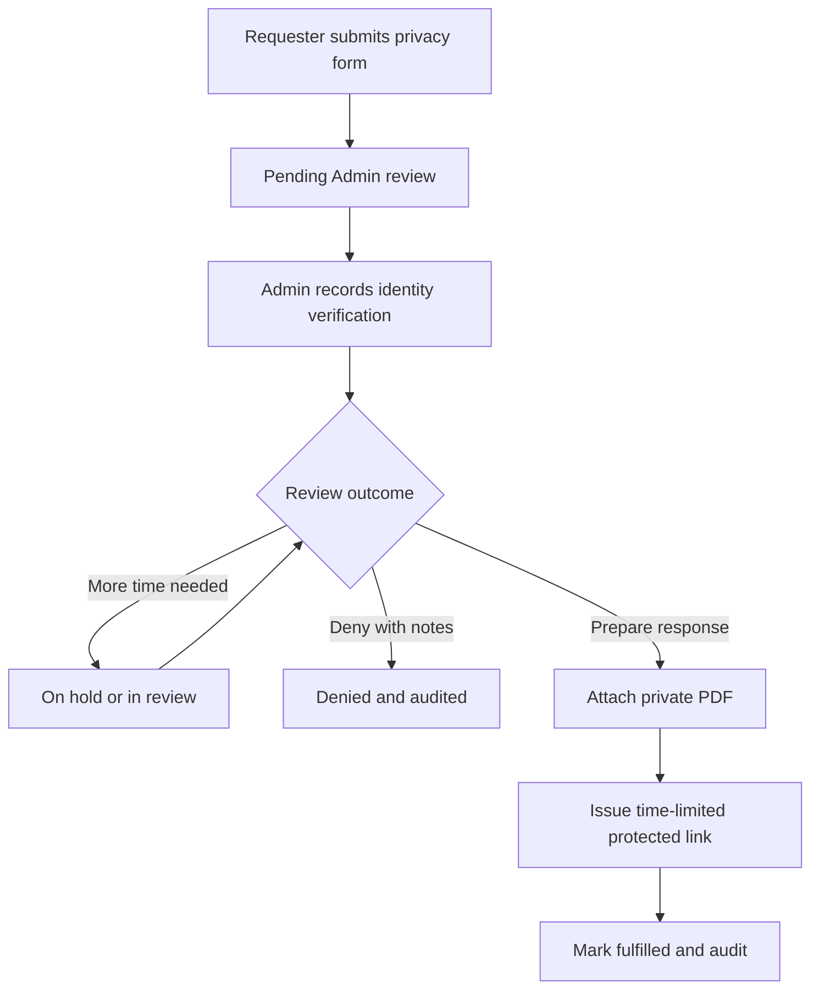

---

## 12. Employee Self-Service, Attendance, Leave, and Scheduling

### `HRMS/my_profile.php` and `my_profile.php`

Purpose: let employees maintain personal information and view their own workforce data.

Features:

- Update allowed personal information.
- Upload or remove profile picture.
- View attendance calendar.
- View leave balances.
- Request overtime.
- Use time-in/time-out features where supported.
- View related announcements, notifications, and payslips.

### `HRMS/attendance.php`

Purpose: allow HR/Admin to maintain attendance infrastructure and records.

Features:

- Encode or correct attendance.
- Add or delete holidays.
- Add or delete shift swaps.
- Repair or migrate attendance tables where the maintenance action is available.

### Leave

Leave requests are submitted by employees or HR users according to role and are reviewed by supervisors, HR, or Admin depending on the workflow. Leave balances and leave logs are maintained for traceability.

### Overtime

Employees submit overtime requests. Supervisors can approve, reject, or log overtime. Approved overtime becomes relevant to payroll preparation.

### Official business

Employees submit official-business requests. Supervisors approve or reject them according to team workflow.

### Schedules and shifts

HR and authorized managers view employee schedules, shifts, positions, and departments. Supervisors view schedules for their teams. Shift swaps and holidays are part of attendance planning.

### Late time-in

Employees or POS users can submit late time-in requests. HR, HR Manager, Admin, or supervisors review them according to the applicable path.

### Attendance and workforce flowchart

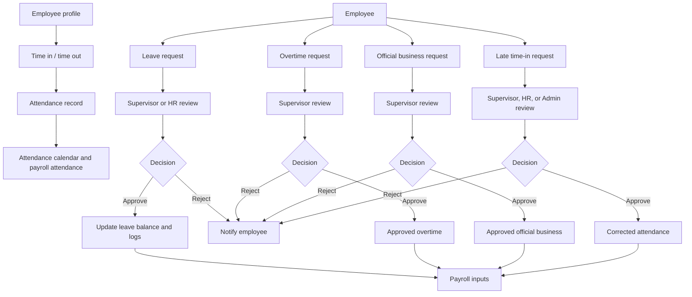

---

## 13. Supervisor Operations

Supervisor pages are guarded by `requireSupervisorRole()` and generally operate on the supervisor's assigned team.

| Page | Purpose |
|---|---|
| `supervisor_dashboard.php` | Team KPIs and pending requests. |
| `supervisor_attendance.php` | Team attendance and corrections. |
| `supervisor_schedule.php` | Team schedule viewing. |
| `supervisor_leave.php` | Approve or reject team leave. |
| `supervisor_overtime.php` | Approve, reject, or log overtime. |
| `supervisor_official_business.php` | Approve or reject official-business requests. |
| `supervisor_late_timein.php` | Approve or reject late time-in requests. |
| `supervisor_performance.php` | Add or delete merit/demerit records. |
| `supervisor_inventory.php` | Submit or cancel inventory restock requests. |
| `supervisor_pos_monitor.php` | Monitor POS activity. |
| `supervisor_reports.php` | Produce printable team reports. |
| `supervisor_purchase_orders.php` | Submit and track curated supervisor supply requests. |
| `supervisor_catalog_security.php` | Set or change the private-catalog password. |

The supervisor layer exists to move day-to-day team decisions closer to the team while keeping HR and Admin responsible for higher-level personnel control.

---

## 14. Payroll and Payslips

Payroll is the formal process that converts employee, attendance, approved overtime, deductions, and pay data into controlled payroll records and released payslips.

### Payroll pages

| Page | Purpose |
|---|---|
| `HRMS/payroll/payroll.php` | Payroll calculation and encoding dashboard. |
| `HRMS/payroll/save_record.php` | JSON payroll record creation or update. |
| `HRMS/payroll/submit_for_approval.php` | HR/HR Manager submit selected draft employee records for approval. |
| `HRMS/payroll/accountant.php` | Read-only Accountant view of submitted payroll batches. |
| `HRMS/payroll/approve_record.php` | Finance or Admin approval/rejection of pending payroll. |
| `includes/payroll_release.php` | Finance/Admin payment and release workflow. |
| `HRMS/payroll/history.php` | Payroll history and records. |
| `HRMS/payroll/employees.php` | Payroll employee lookup. |
| `HRMS/payroll/attendance.php` | Payroll attendance view and CSV export. |
| `HRMS/payroll/payslip_lookup.php` | Payslip lookup. |
| `HRMS/payroll/thirteenth.php` | Thirteenth-month payroll support. |
| `HRMS/payroll/capital_transaction.php` | Admin capital transaction entry. |
| `HRMS/payroll/upload_cash_ack.php` | Upload signed cash-release acknowledgement. |
| `HRMS/payroll/cash_ack_download.php` | Protected acknowledgement viewer. |
| `HRMS/payroll/get_employee_payslips.php` | JSON payslip endpoint. |

### Payroll features

- Attendance-based inputs.
- Approved overtime inputs.
- Payroll record creation and editing.
- HR/HR Manager submission of selected draft employee records.
- Read-only Accountant visibility into submitted batches.
- Finance or Admin approval/rejection, followed by separate Finance/Admin payment and release.
- Payslip lookup and employee viewing.
- Signed cash acknowledgement upload.
- Payroll history and audit logging.
- Statutory deduction helpers for SSS, PhilHealth, Pag-IBIG, and withholding tax.
- Thirteenth-month support.

### Payroll flowchart

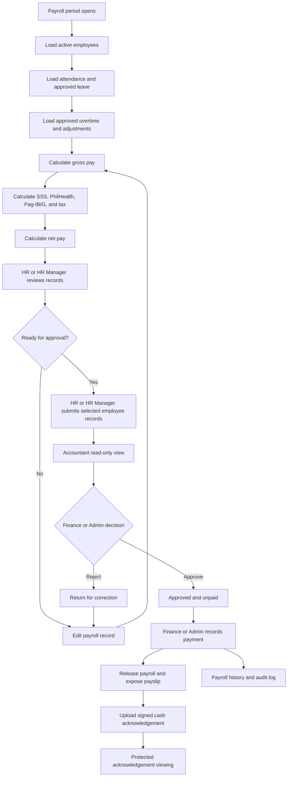

---

## 15. Announcements and Notifications

### POS notifications

`notifications.php` provides controlled access to operational notifications such as stock, merit/demerit, and expense workflow events. Users can mark notifications read, archive them, and unarchive them according to access rules.

### HRMS notifications

`HRMS/hr_notifications.php` supports marking one or all notifications as read, archiving read notifications, and unarchiving them.

### HRMS contracts, letters, and privacy requests

The contracts/letters lifecycle, recipient signing/declining, reminder
processing, and the Admin-only privacy-request review and protected-response
workflow are detailed in [Recruitment and Employee Lifecycle](#11-recruitment-and-employee-lifecycle).
Letter status events and privacy-request decisions are auditable; they are
separate from ordinary announcement and notification flows.

### Announcements

`announcements.php` and `HRMS/announcements.php` expose company-wide messages. Authenticated users can read announcements. HR, HR Manager, and Admin can create and manage announcements. Approval, rejection, and takedown actions are supported in HRMS.

Announcements provide organization-wide communication, while notifications provide event-specific task and status information.

---

## 16. Reports, Exports, and Auditability

### POS and finance reports

`reports.php` provides:

- Sales summary.
- Best-selling products.
- Per-cashier reporting.
- Per-category reporting.
- XLSX/PDF export.

Additional reporting pages include:

- Inventory movement and expiry reports.
- Shift reports.
- Financial statements.
- Financial analysis.
- Financial audit logs.
- Supplier and purchase-order exports.
- Operating-expense exports.

### Export infrastructure

`includes/export.php` supplies:

- `exportToExcel()`.
- `exportToPDF()`.
- `logExport()`.

The application uses bundled FPDF support for PDF generation and records exports in an export log where implemented.

### HRMS reports

HRMS reporting is primarily delivered through dashboards and browser print/save-to-PDF flows. Payroll and attendance provide CSV-oriented outputs. Supervisor reports focus on team activity and workforce decisions.

### Why auditability matters

Audit logs and exports allow management to answer:

- What was sold?
- Who processed the transaction?
- What stock changed?
- Why was an item wasted?
- Who approved a restock, discount, purchase order, expense, leave request, or payroll?
- Which documents were uploaded or viewed?
- What was exported and when?

---

## 17. Uploads, Emails, and Storage

### POS uploads

- `uploads/avatars/`: POS profile images.
- `uploads/products/`: product images.
- `uploads/receipts/`: operating-expense receipts and related evidence.

### HRMS uploads

- `HRMS/uploads/avatars/`: HRMS profile images.
- `HRMS/uploads/applicant_documents/`: applicant requirements.
- `HRMS/uploads/employee_documents/`: employee records.
- `HRMS/uploads/resumes/`: applicant resumes.
- `HRMS/uploads/cash_ack/`: payroll cash acknowledgements.
- `HRMS/uploads/hr_letters/`: HR letter PDF files when uploaded through the
  applicable letter workflow.
- Privacy-request response PDFs are stored separately and delivered through
  a protected download endpoint with expiring access.

Protected endpoints are used for sensitive resumes, applicant documents, employee documents, and payroll acknowledgements rather than relying on unrestricted public file paths.

### Email

PHPMailer is bundled for both application areas. Email functions support:

- POS and HRMS 2FA OTP delivery.
- Applicant interview and requirements messages.
- Hiring-related notifications.
- Other workflow notifications where configured.

The current source inspection identified SMTP configuration in PHP mailer files; production deployment should verify that secrets are not exposed in source and should move them to environment configuration where appropriate.

---

## 18. Database and Functional Data Model

### POS-side functional tables

- `users`: POS accounts and access state.
- `products`, `categories`: sellable catalog data.
- `sales`, `sale_items`, `sale_refunds`: sales and refund records.
- `product_batches`, `stock_logs`: batch and stock history.
- `product_details`, `product_detail_audit`: consumer-facing detail and review history.
- `product_scan_events`: public lookup source and activity.
- AI settings, usage, and product-ingest audit/rate-limit data: provider controls and draft provenance.
- `suppliers`, `vendor_ratings`: supplier data and evaluation.
- `purchase_orders`, `purchase_order_items`: procurement.
- `inventory_requests`: replenishment workflow.
- `discount_requests`, `product_discount_requests`: controlled discount approvals.
- `notifications`, `announcement_reads`: user messaging state.
- `capital_transactions`: capital movement.
- `accounts_payable`, `supplier_payments`: obligations and payments.
- `expense_categories`, `operating_expenses`, `budgets`: expense control.
- `login_ip_throttle`: login protection.
- `export_log`: export traceability.
- `overtime_requests`, `late_timein_requests`, `holidays`: supporting workforce data used by POS workflows.

### HRMS-side functional tables

- `users`, `employees`: accounts and employee identity.
- `attendance`, `holidays`, `shifts`, `employee_weekly_shifts`, `shift_swaps`: workforce time and scheduling.
- `leave_requests`, `leave_request_logs`, `leave_credits`: leave workflow and balances.
- `late_timein_requests`, `overtime_requests`, `official_business_requests`: employee requests.
- `supervisor_teams`: team ownership.
- `performance_records`: merit and demerit records.
- `employee_documents`, `employee_status_logs`, `position_history`: personnel records.
- `job_applicants`, `job_applicant_logs`, `applicant_documents`: recruitment lifecycle.
- `application_form_fields`: configurable application form.
- `hr_letters`, `hr_letter_templates`, `hr_letter_events`, `hr_letter_email_log`: official correspondence and recipient responses.
- `data_subject_requests`: privacy intake, identity verification, review, and response metadata.
- `payroll_records`, `payroll_logs`: payroll processing and history.
- `announcements`, `hr_audit_log`, `app_settings`: communication, auditing, and configuration.
- `capital_transactions`: HRMS/payroll-side capital entries where used.
- `login_ip_throttle`: HRMS login protection.

The local schema was verified against the restored October 3, 2026 database
exports. Production deployments should verify their own schema, indexes,
constraints, and migration state before release.

---

## 19. Backup and Recovery

### `backup/backup_databases.php`

Purpose: create database backups for both `grocery_pos` and `hrms`.

Features:

- CLI-oriented operation.
- Gzip-compressed `.sql.gz` output.
- Configurable retention.
- Windows launcher support through `backup_databases.bat`.

### `backup/README.md`

Provides Task Scheduler guidance for recurring backups.

### Backup limitation

The database backup contains database records only. Uploaded files such as resumes, employee documents, product images, receipts, avatars, and cash acknowledgements are not included in the database backup according to the current source map. A complete disaster-recovery plan must separately back up the upload directories.

### Backup flowchart

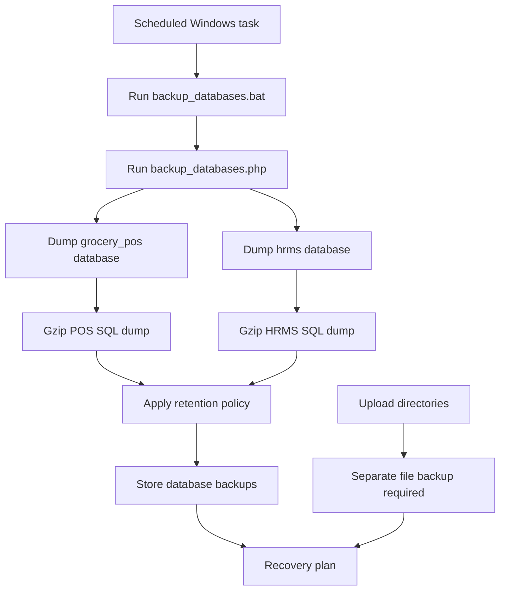

---

## 20. End-to-End Business Scenarios

### Scenario A: Customer purchase

1. A customer views the public catalog.
2. The customer visits the physical store.
3. A cashier signs into POS with password and 2FA.
4. The cashier scans products.
5. The system validates product activity and stock.
6. The cashier applies eligible discounts or requests approval for custom discounts.
7. The cashier completes checkout.
8. The system records the sale, reduces stock, writes stock movement, and issues a receipt.
9. Sales become available to shift, product, category, and finance reports.

### Scenario B: Low-stock replenishment

1. Inventory Staff sees a low-stock alert.
2. Inventory Staff or a Supervisor submits a restock request.
3. The request is validated.
4. Finance reviews the financial obligation.
5. A purchase order is created or linked.
6. The supplier delivers goods.
7. Inventory receives the order.
8. Product stock and batches are updated.
9. Accounts payable records the obligation and later payment.
10. The movement appears in inventory and financial reports.

### Scenario C: New employee hiring

1. A public applicant submits the dynamic application form and resume.
2. HR reviews the application.
3. The applicant progresses through initial screening and interview.
4. HR sends requirements instructions.
5. The applicant uploads required documents through the protected token portal.
6. HR verifies the documents and confirms the hire.
7. An employee record and account are created.
8. The employee is assigned a position and status.
9. Eligible POS positions are synchronized for POS access; HRMS-only positions use HRMS access.

### Scenario D: Monthly payroll

1. HR opens the payroll period.
2. The system loads employees, attendance, leave, overtime, and adjustments.
3. Payroll calculates gross pay and statutory deductions.
4. HR reviews and corrects records.
5. HR or HR Manager submits selected employee records; other drafts can remain unsubmitted.
6. The Accountant can inspect the submitted batch in a read-only view.
7. Finance or Admin approves or rejects the pending records.
8. Rejected records return for correction and resubmission.
9. Finance or Admin records payment for approved payroll, which releases payslips.
10. Signed cash acknowledgements are uploaded and protected.
11. Payroll history and audit logs retain the process record.

### Scenario E: Verified product information and customer lookup

1. Inventory Staff captures a nutrition-panel or front-of-package image.
2. AI proposes product information; any web-enriched fields retain source/audit metadata and remain unverified.
3. Inventory Staff reviews and submits the draft; Admin verifies or rejects it.
4. Inventory Staff prints a QR shelf label for the product.
5. A customer opens the product from the catalog or scans via phone/kiosk.
6. The public lookup displays the available product details and records its source.
7. Inventory Staff uses Scan Insights to prioritize unverified products; stock recommendations remain advisory.

### Scenario F: Privacy request and response

1. A requester submits the public privacy form with a request type and details.
2. Admin records identity verification and reviews the request.
3. If responding, Admin attaches a private PDF and marks the request fulfilled; a protected response link expires after seven days.
4. A denial requires internal notes; status changes and response actions are audited.

### Scenario G: Contract or official letter

1. HR creates a draft from a template or editor and submits it.
2. Admin or HR Manager approves or rejects it.
3. An approved applicant contract is emailed to the final-stage applicant.
4. The recipient uses the secure link to accept/sign or decline.
5. HR can process eligible reminder emails; events are retained in letter history.

---

## 21. Feature and Access Summary

| Area | Main purpose | Primary roles |
|---|---|---|
| Public landing page | Public business and system entry | Public |
| Product catalog | Browse available products | Public |
| Product details and nutrition comparison | Review available product information and compare recorded nutrition | Public |
| Product lookup and labels | Scan/enter a barcode or QR; print QR shelf labels and supported POS EAN-13 labels | Public lookup; Inventory Staff/Admin labels |
| Private catalog access | Supervisor-password-gated catalog mode | Supervisor/Admin configure; public visitor enters password |
| Account recovery | Request a POS/HRMS reset; review and issue a one-time verified-email link | User, HR, Admin |
| POS checkout | Process sales and receipts | Cashier, Admin |
| Shift reports | Reconcile cashier activity | Cashier, Admin |
| Product management | Maintain sellable products | Inventory Staff, Admin |
| Product detail review and AI intake | Draft, review, verify/reject product details; configure AI provider | Inventory Staff, Admin |
| Scan insights and stock recommendations | Review lookup activity; read-only planning | Inventory Staff, Admin |
| Inventory dashboard | Monitor stock health | Inventory Staff, Admin |
| Stock requests | Control replenishment | Inventory Staff, Supervisor, Finance |
| Product batches | Track expiry and waste | Inventory Staff |
| Suppliers | Maintain supplier records | Inventory Staff, Finance, Admin |
| Vendor ratings | Evaluate suppliers | Inventory Staff, Finance, Admin |
| Purchase orders | Formalize purchases | Authorized operations, Finance |
| Finance dashboard | Review pending financial actions | Finance, Admin |
| Operating expenses | Control expense evidence and payment | Finance and authorized submitters |
| Budgets | Compare plans with actuals | Finance |
| Financial statements | Produce formal reports | Finance, Admin |
| Recruitment | Collect and process applicants | Public, HR, HR Manager, Admin |
| HR contracts and letters | Draft, approve, email, receive signature/decline, reminders | HR, HR Manager, Admin; recipient |
| Privacy requests | Public intake, identity verification, review, protected response | Public requester, Admin |
| Employee management | Maintain workforce records | HR, HR Manager, Admin |
| Documents | Secure employee/applicant files | HR, HR Manager, Admin by permission |
| Attendance | Maintain time records | Employees, Supervisors, HR, Admin |
| Leave | Request and approve leave | Employees, Supervisors, HR, Admin |
| Overtime | Request and approve overtime | Employees, Supervisors, HR, Admin |
| Official business | Approve official assignments | Employees, Supervisors |
| Scheduling | Manage shifts and swaps | HR, HR Manager, Supervisors |
| Performance | Maintain merit/demerit records | Supervisors, HR/Admin oversight |
| Payroll preparation | Calculate, edit, and submit selected employee records | HR, HR Manager |
| Payroll review | Read-only submitted-batch view | Accountant (HRMS role) |
| Payroll approval and release | Approve/reject and separately record payment | Finance, Admin |
| Payslips | Let employees view released pay | Employees, POS-linked staff |
| Announcements | Company-wide communication | All authenticated users; managers publish |
| Notifications | Event and approval alerts | Authenticated users by access |
| Reports and exports | Analysis and evidence | Authorized module roles |
| Backups | Preserve database records | System operator / scheduled task |

---

## 22. Complete System Purpose

HCI GroceryOne exists to provide one controlled operational environment for a grocery business. Its value is not limited to recording sales. It creates a chain of accountability:

- Products are presented publicly and sold through an authenticated cashier workflow.
- Sales reduce inventory and create financial information.
- Inventory shortages become controlled replenishment requests.
- Procurement creates purchase orders and accounts payable.
- Finance approves obligations, tracks expenses, and produces statements.
- Recruitment converts public applicants into managed employees.
- Employee attendance, leave, overtime, and performance become structured HR records.
- Approved workforce information supports payroll.
- Payroll approval creates payslips and release evidence.
- Notifications, exports, audit logs, protected files, and backups support traceability and continuity.

In short, HCI GroceryOne connects the storefront, the back office, the workforce, and the financial record into one system with role-based access and approval workflows.

This purpose statement and the master chart summarize how business areas
connect; use the module inventories and focused flowcharts above for the
implemented user workflows. Internal helper functions and every request
validation branch are intentionally not represented as separate business
features.

---

## 23. Verification Notes and Current Boundaries

The documentation is based on the PHP files, shared includes, route names, role guards, action names, embedded migrations, and source-level behavior available in the workspace.

The following require production verification before being treated as deployment guarantees:

- Exact live MySQL schema and migration state.
- Actual `.env` values and production database names.
- SMTP provider configuration and credential storage.
- Whether every listed email notification is enabled in production.
- Runtime behavior of duplicate or alternate pages such as `HRMS/login1.php`.
- Backup storage location, permissions, restore testing, and off-site retention.
- Separate backup coverage for uploaded files.
- Final role assignments and organization-specific approval policies.

This document describes the current system behavior and intended business purpose; it does not replace production security review, database backup testing, or a formal authorization matrix.

## 24. Front-photo nutrition lookup

Product label intake supports two explicit photo modes. A nutrition-panel photo
uses Gemini vision with structured JSON output and records
`nutrition_source=label_photo`. A front-of-package photo uses three separate
calls: vision reads the visible brand/name, Gemini web grounding searches for
nutrition information, and a JSON-only structuring call normalizes the result.

Web-derived nutrition records store `nutrition_source=web` and
`nutrition_source_url`, are always saved as `needs_review`, and cannot be
verified directly from the web result. The reviewer must compare the result
against the physical package first. Web searches have their own configurable
`daily_search_cap` in AI Settings; the normal AI call cap still applies to all
three calls. If no reliable web result is found, the UI instructs the stocker
to photograph the nutrition panel instead.

When a nutrition-panel photo is used, the visible label remains the source of
truth for nutrition, barcode, brand, and other extracted values. If a brand or
product name is available, the system may additionally perform one grounded
product-information search for blank descriptive fields: description,
ingredients, allergens, storage notes, unit, and net weight. A separate
JSON-only call structures those findings. Search results never overwrite a
non-empty photo value, and search failures, `NOT_FOUND`, or a reached daily
search cap do not prevent the photo extraction from being saved.

Any field filled from this enrichment is recorded in the AI audit as
`web_fields` with `web_search_used=true` and `web_source_url`, displayed with
an amber `WEB` badge during review, and keeps the record in `needs_review`.
The normal daily AI-call cap applies to all AI calls; `daily_search_cap` is
shared by both `nutrition_search` and `product_info_search`.

## 25. Current Release Checklist

The checked-out source includes product-information review, public
barcode/QR lookup, private catalog access, password recovery, procurement
supplier e-signatures, HR letters, privacy requests, finance, and HRMS
workflows. The remaining work before a production release is
deployment-specific verification, not a claim that the local October 3
database snapshot is current:

1. Apply the required migrations to the correct databases, including
    `2026_10_03_hrms_purchase_order_requests.sql`, after taking a backup.
2. Configure production environment values, HTTPS, secure session cookies,
    least-privilege database accounts, SMTP, and rotated secrets.
3. Run the relevant CLI contracts and end-to-end role workflows against a
    staging copy, including product review, public scan, supplier e-signature
    and procurement receiving, expense/payment, password recovery, HR letter
    responses, privacy requests, attendance, and payroll release.
4. Restore a recent database backup into a clean test database and separately
    verify backup and recovery for uploaded files.
5. Confirm the supplied PCU map pin is the intended attendance area, and
    verify the geofence radius, accuracy policy, retention rules, privacy
    notices, and contact details with the business.
6. Review external AI provider data terms and keep HR, payroll, attendance,
    resumes, and employee documents out of external AI processing unless an
    approved privacy review explicitly permits it.

The system does not provide public customer checkout. AI output remains
untrusted draft data: it must not approve purchases, expenses, payroll,
discounts, hiring, or attendance changes, and it must not bypass human product
verification.
